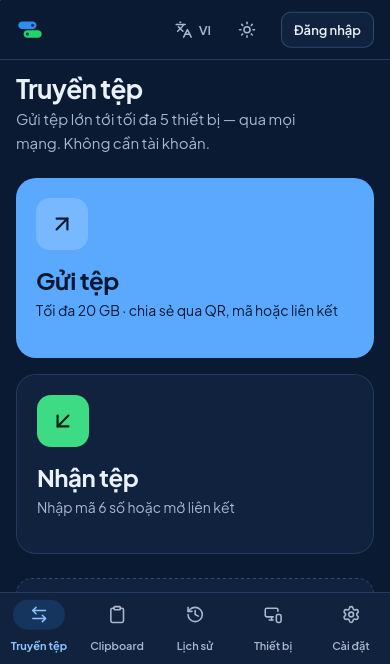
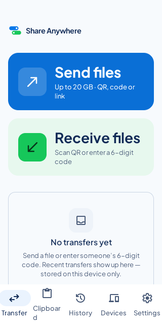
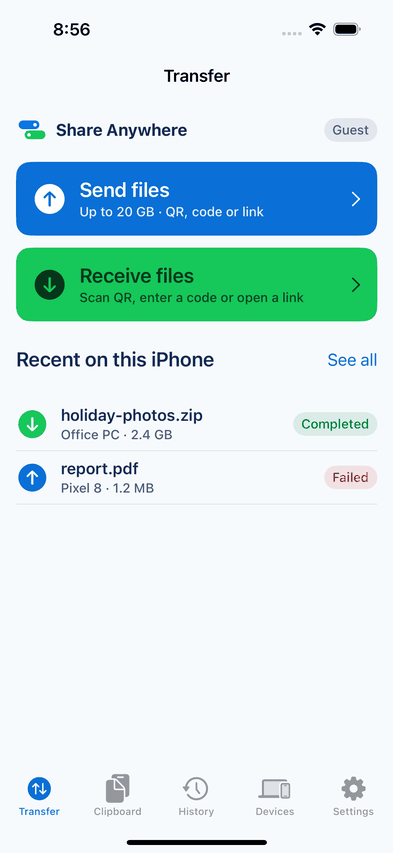
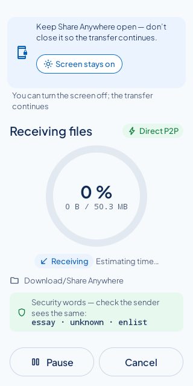
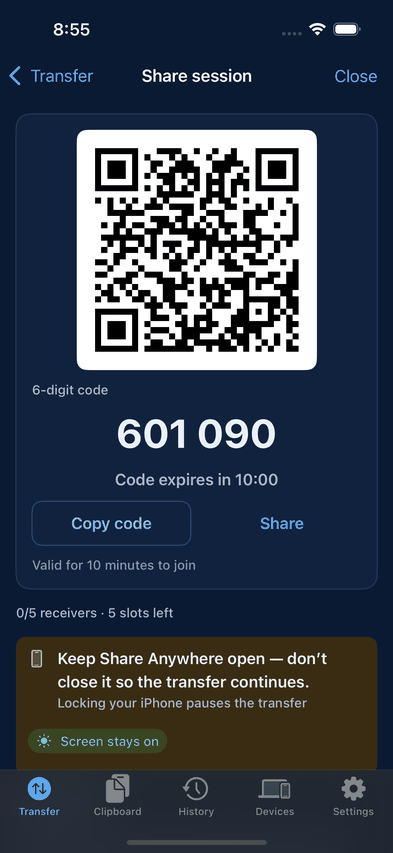

# Share Anywhere

Cross-platform peer-to-peer file sharing and clipboard sync for Web, Android, and iOS. File sharing is guest-first: no account is needed to send or receive. Only Clipboard Sync and a few account-wide features require signing in.

Status: **every phase (0 to 9, with 5A and 5B) implemented** on Web, Android, iOS and the backend. What is tested, and on what, is in `docs/phases/reports/PHASE_9_REPORT.md` (the consolidated final report); what is not done or not verified is in [`KNOWN_LIMITATIONS.md`](KNOWN_LIMITATIONS.md). Nothing has run on a real phone or across real networks yet; store submission is blocked on account deletion, which is not built.

## Screenshots

Captured by CI: the Web from the nightly `visual-snapshots` job (Playwright, iPhone 14 profile on WebKit, Vietnamese, dark), Android from the emulator screenshot suite (API 34), iOS from the simulator screenshot suite (iPhone 16, iOS 18.5).

| Web (mobile browser) | Android | iOS |
|---|---|---|
|  |  |  |
| |  |  |

## Where things are

| Path | What |
|---|---|
| `CLAUDE.md` | Standing engineering rules |
| `CLAUDE_DESIGN_AND_BUILD_PROMPT.md` | How to run a phase, document map |
| `design/claude-design/` | Claude Design handoff, the UI source of truth (imported in Phase 0) |
| `docs/` | Requirements, architecture, screen map, security model, API, testing strategy, ADRs, phase plans and reports |
| `backend/` | Go backend (modular monolith) |
| `web/` | React + TypeScript web app |
| `android/` | Native Android app (Kotlin, Jetpack Compose), Gradle project |
| `ios/` | Native iOS app (SwiftUI): XcodeGen `project.yml`, the app, and the `ShareAnywhereCore` Swift package |
| `shared/design/tokens.json` | Design tokens; `pnpm tokens` generates platform files |
| `infra/` | coturn and Caddy configuration |
| `docs/runbooks/` | Deploy, backup and restore, incidents, real-device checklists |
| `docs/RELEASE_CHECKLIST.md`, `docs/PERFORMANCE.md` | Release steps (signing, store policy) and measured throughput and memory ceilings |

## Quick start (Docker Compose)

Requirements: Docker with Compose v2.

```bash
cp .env.example .env
```

```bash
docker compose up --build
```

Then open <https://localhost:8443> and accept the local certificate (Caddy's internal CA). Health checks: `https://localhost:8443/healthz` and `https://localhost:8443/readyz`.

## Local development without Docker

Requirements: Go 1.27, Node 22, pnpm 10.28 (`npm install -g pnpm@10.28.0`), and optionally PostgreSQL 16.

```bash
pnpm install
```

```bash
cd backend && go run ./cmd/server
```

```bash
pnpm --filter @share-anywhere/web dev
```

The web dev server runs on <http://localhost:5173> and proxies `/v1`, `/healthz`, and `/readyz` to the backend on port 8080. The brand and token preview is at <http://localhost:5173/brand> in development builds only.

## Android app

Requirements: JDK 17 or newer, the Android SDK with platform 35 and build-tools 35.0.0 (`ANDROID_HOME` set, or `sdk.dir` in an uncommitted `android/local.properties`). The Gradle wrapper downloads and checksum-verifies Gradle 8.14.3.

```bash
cd android && ./gradlew assembleDebug
```

The debug APK is `android/app/build/outputs/apk/debug/app-debug.apk`. It talks to the backend at `http://10.0.2.2:8080`, which is the host machine as the Android emulator sees it, so `docker compose -f docker-compose.ci.yml up -d --build --wait` (plain HTTP on port 8080) is the quickest backend for an emulator. Point a build elsewhere with `-Pbackend=http://<host>:8080`; debug builds allow cleartext only to `10.0.2.2`, `localhost`, and `127.0.0.1` (use `adb reverse tcp:8080 tcp:8080` for a USB device and `-Pbackend=http://localhost:8080`). Release builds need `-PreleaseBackend=https://…` and are signed outside the repository.

```bash
cd android && ./gradlew testDebugUnitTest lintDebug ktlintCheck assembleDebugAndroidTest
```

```bash
cd android && ./gradlew connectedDebugAndroidTest -Pbackend=http://10.0.2.2:8080
```

The last command needs a running emulator or device (CI uses API 34, `.github/workflows/android-emulator.yml`). Theme tokens, string resources, and API models are generated from `shared/` by `pnpm tokens`, `pnpm i18n`, and `pnpm protocol`; never edit `Tokens.kt`, `Api.gen.kt`, or `res/values*/strings.xml` by hand. After changing a dependency, refresh the lockfiles with `./gradlew :app:dependencies buildEnvironment --write-locks`.

## iOS app

Requirements: macOS with Xcode 16.4 (iOS 18 simulator runtime). `scripts/ios-tools.sh` installs the pinned XcodeGen, SwiftLint and SwiftFormat into `.tools/`.

```bash
scripts/ios-tools.sh && (cd ios && ../.tools/xcodegen/bin/xcodegen generate)
```

Open `ios/ShareAnywhere.xcodeproj` and run the `ShareAnywhere` scheme on a simulator; the Debug build talks to `http://127.0.0.1:8080` (the plain-HTTP CI backend). The core package's tests also run on Linux:

```bash
cd ios/ShareAnywhereCore && swift test
```

Device builds and TestFlight need your own Team ID and signing, set at build time and never committed (`docs/RELEASE_CHECKLIST.md` §4).

## Production

Single-VM deployment with Docker Compose, Caddy (automatic HTTPS) and coturn: `docs/runbooks/deploy.md` (`docker-compose.prod.yml`, `infra/caddy/Caddyfile.prod`). Backups: `docs/runbooks/backup-restore.md`.

## Checks

```bash
pnpm tokens:check && pnpm i18n:check && pnpm protocol:check && pnpm test:scripts && pnpm lint:md
```

```bash
cd backend && go vet ./... && golangci-lint run ./... && go test -race ./...
```

```bash
pnpm --filter @share-anywhere/web format:check && pnpm --filter @share-anywhere/web lint && pnpm --filter @share-anywhere/web typecheck && pnpm --filter @share-anywhere/web test && pnpm --filter @share-anywhere/web build
```

CI runs the same checks plus secret scanning, vulnerability scanning, image builds, and a Compose smoke test (`.github/workflows/ci.yml`).
