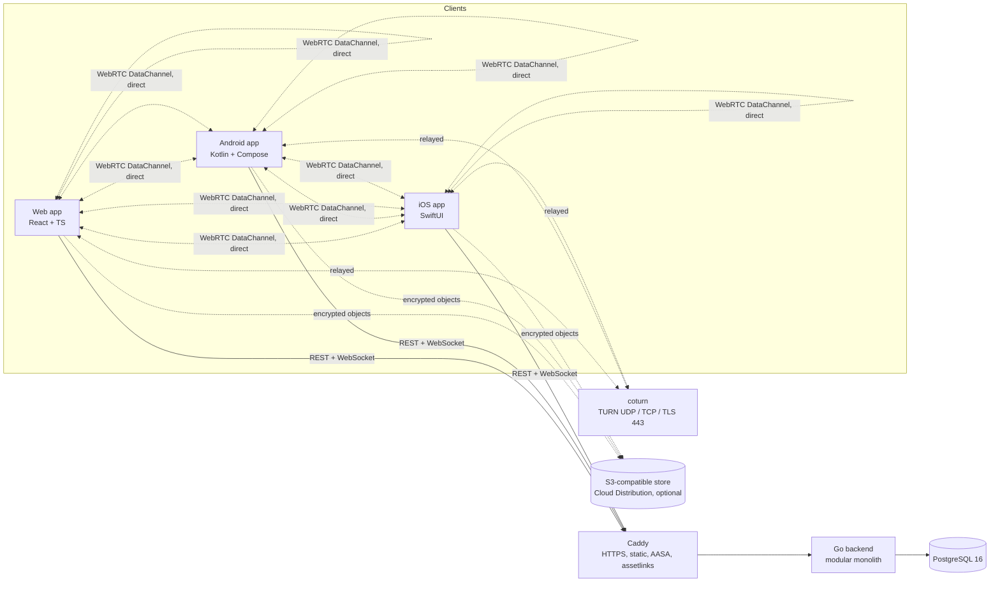

# Architecture

Source of truth for components, flows, the server data model, client-side storage, and client lifecycle behavior (including keeping the screen on). Product decisions live in `docs/PRODUCT_REQUIREMENTS.md` §2; endpoints and access levels in `docs/API.md`; security rules, lifetimes, and rate limits in `docs/SECURITY_MODEL.md`; screens in `docs/UX_SCREEN_MAP.md`.

Status: **planned**. Phases update this file as they implement each part and record deviations in `docs/ADR/`.

---

## 1. System overview



- **Backend** (`backend/internal`, eight packages max): `platform` (config, DB, HTTP, access-level and rate-limit middleware, logging, WebSocket hub and tickets), `devices` (anonymous identity, tokens, refresh rotation), `auth` (accounts layered on devices, ADK storage, history sync), `sharing` (sessions, participants, files, capabilities, join modes, protected mode), `transfers` (records and state machine), `signaling`, `turncreds`, `clipboard`.
- **Clients own the transfer engine**: chunking, hashing, flow control, bitmap resume, route selection, ETA, and the keep-awake controller. The backend authorizes, coordinates, and records.
- **Deployment**: one Docker Compose stack (Caddy, backend, PostgreSQL, coturn; MinIO only when Cloud is enabled). Single backend instance in MVP; rate-limit buckets live in process memory.

## 2. Platform building blocks

| Concern | Web | Android | iOS |
|---|---|---|---|
| UI | React, Tailwind, TanStack Query | Jetpack Compose, Material 3 | SwiftUI, `@Observable` |
| WebRTC | Browser APIs | `stream-webrtc-android` or `org.webrtc` (ADR) | `stream-webrtc-ios` or Google `WebRTC` xcframework (ADR) |
| Refresh secret | `HttpOnly` cookie | Keystore-backed encrypted storage | Keychain, `ThisDeviceOnly` |
| Local history | IndexedDB | Room | Core Data or GRDB (ADR; SwiftData needs iOS 17) |
| Resume bitmap | IndexedDB | Room | Sidecar file next to the partial download |
| Receive storage | File System Access API or OPFS + Service Worker download | SAF document or tree URI | App Documents (visible in Files) or a picked folder via security-scoped bookmark |
| Background transfers | Tab must stay open | Foreground service `dataSync` + partial wake lock + Wi-Fi lock | Not possible beyond ~30 s; checkpoint and resume on return |
| Keep screen on | Screen Wake Lock API | `FLAG_KEEP_SCREEN_ON` on the transfer screen window | `isIdleTimerDisabled` |

## 3. Identity flows

### 3.1 First launch (every client, no account)

```mermaid
sequenceDiagram
  participant App
  participant API as Backend
  App->>App: Show Welcome (first launch only)
  App->>API: POST /v1/devices/anonymous (platform, name, [PoW])
  API-->>App: device_id, access token (15 min), refresh secret
  App->>App: Store refresh secret securely; keep access token in memory
  App->>App: Start sharing → Transfer home
  Note over App,API: If bootstrap fails, Transfer home still opens with an inline retry
```

### 3.2 Refresh

The client refreshes shortly before expiry with `POST /v1/devices/token`. The server rotates the secret; presenting an old secret revokes the device. Web sends the cookie plus `X-SA-Refresh: 1`.

### 3.3 Sign in (optional, Phase 5A)

`POST /v1/auth/signin` is called with the current device token and the user's choices (`add_device`, `copy_history`). The device ID does not change, so running transfers continue. The next access token carries `acct` and `dl`. Sign-out removes the device from the account, revokes the account session, wipes ADK material, and returns a new anonymous identity.

### 3.4 WebSocket

`POST /v1/ws/ticket` → connect `/v1/ws?ticket=…` → server checks `Origin`, consumes the ticket, binds the socket to the device and account.

## 4. Share session and join flows

### 4.1 Create

Sender selects files → `POST /v1/sessions` with file metadata and `require_approval` (default `false`) → server returns a six-digit code, a link token, a QR payload, and `join_window_ends_at` (10 minutes later). The session is `WAITING` with an open join window; the sender's keep-awake controller becomes active (§7).

### 4.1b Join window

Code, link, and QR share one join window (`docs/SECURITY_MODEL.md` §3.0). The server checks the window on `resolve-code`, `resolve-link`, and `join`, and caps the join ticket at the window end. A background job and the `join` path both close the window when it times out, when the fifth receiver arrives, or on Stop accepting, and emit `SESSION_UPDATED`. `renew` (Create new code) replaces the code HMAC and the link token and opens a new window. Clients count down from `join_window_ends_at` using server time offsets from the API response, never only the local clock. Joined receivers, signaling, TURN, and transfers do not depend on the window.

### 4.2 Open join (default)

```mermaid
sequenceDiagram
  participant R as Receiver
  participant API as Backend
  participant S as Sender
  R->>API: resolve-code or resolve-link
  API-->>R: Preview (sender name, badge, files) + join ticket
  R->>R: Tap Receive (Web: choose save target)
  R->>API: POST /sessions/{id}/join (ticket)
  API->>API: Lock session row, check slot, blocks, accepting
  API-->>R: Participant JOINED + security words
  API-->>S: PARTICIPANT_JOINED (name, badge, security words)
  S->>S: Toast / notification; Remove and Block available
  S-->>R: Signaling (OFFER / ANSWER / ICE) → transfer starts
```

### 4.3 Approval required, or protected mode for code joins

Same as above until `join`, which returns `REQUESTED`. The sender sees a request card with security words and approves, rejects, or blocks. On approval the participant becomes `JOINED` and signaling starts. Protected mode (`docs/SECURITY_MODEL.md` §3.1) forces this path for joins made with a six-digit code, in every session, while it is active.

### 4.4 Sender controls

Remove (revoke capabilities, close the peer connection, free the slot), Block (remove + refuse rejoin from device ID and IP /64), Stop accepting (ends the join window now), Create new code (new code, link, and QR with a fresh 10-minute window; old ones invalid), toggle Require approval (future joins only), Close session.

### 4.5 State machines

- Session: `CREATED → WAITING → ACTIVE → COMPLETED | PARTIALLY_COMPLETED | CLOSED | EXPIRED | CANCELLED`.
- Join window: `OPEN → EXPIRED` (10 minutes) `| ENDED_FULL | ENDED_BY_SENDER`; `renew` from any of these except while full returns to `OPEN` with a new code. A session with an ended window and no receivers stays `WAITING` until the sender creates a new code, closes it, or it hits the idle or maximum lifetime.
- Participant: `REQUESTED` (approval path only) `→ JOINED → LEFT | REMOVED | BLOCKED`; `REQUESTED → REJECTED | BLOCKED`.
- Transfer (per file and receiver): `PENDING → CONNECTING → TRANSFERRING ⇄ PAUSED`, `TRANSFERRING → DISCONNECTED → RECONNECTING → RESUMING → TRANSFERRING`, terminal `COMPLETED | FAILED | CANCELLED`.

All transitions are idempotent on the server and validated against the caller's role.

## 5. Transfer engine

Specified in `docs/TRANSFER_PROTOCOL.md` (Phase 3). Summary: 4 MiB blocks, 64 KiB frames, `bufferedAmountLowThreshold` backpressure, SHA-256 per block and per file, ACK after write and verify, persisted missing-block bitmap, resume by bitmap exchange, re-authentication with the transfer capability on every connect. One PeerConnection per receiver; a sender-side scheduler with a bounded block cache keeps a slow receiver from stalling the others (Phase 4).

## 6. Routes and TURN

The client picks the route per receiver: Direct P2P → TURN UDP → TURN TCP/TLS 443 → Cloud (signed-in sender, consented, within budget) → queue and retry. It observes `getStats()`, smooths with EWMA, applies hysteresis, and migrates by re-handshaking and exchanging the bitmap (Phase 8). `turncreds` issues coturn `use-auth-secret` HMAC credentials with username `expiry:participant_id` to the sender and `JOINED` receivers of an `ACTIVE` session: guest TTL 30 min, account 60 min, coturn `user-quota` 6, relay byte caps per session (`GUEST_RELAY_BYTES_CAP` 25 GB, `ACCOUNT_RELAY_BYTES_CAP` 100 GB) enforced by stopping renewal.

## 7. Client lifecycle and keeping the screen on

### 7.1 When the screen is kept on

A single **keep-awake controller** per client decides, from transfer and session state, whether to hold the screen on. It holds while any of these is true, the setting **Keep screen on during transfers** (default on, stored locally per device) is on, and the user has not tapped the screen-on pill off for the current transfer (that choice resets for the next session):

- the user is a sender whose session has an **open join window** (waiting for receivers, at most 10 minutes per window) or has transfers in progress;
- any transfer this device takes part in is `CONNECTING`, `TRANSFERRING`, `RESUMING`, `RECONNECTING`, or verifying;
- the user is a receiver waiting for approval (approval on or protected mode).

It releases as soon as none is true: every transfer is completed, failed, cancelled, or paused; the session is closed or expired; the join window ended with no transfer in progress; the receiver left or was removed; or the setting is turned off. Waiting for receivers therefore holds the screen for at most 10 minutes per join window.

### 7.2 Platform mechanics

| | Web | Android | iOS |
|---|---|---|---|
| Hold | `navigator.wakeLock.request('screen')` | `FLAG_KEEP_SCREEN_ON` on the Activity window (`View.keepScreenOn` from a Compose `DisposableEffect`) while a send, receive, or session screen is visible | `UIApplication.shared.isIdleTimerDisabled = true` while the scene is active |
| Release | `sentinel.release()` | Clear the flag | Set `isIdleTimerDisabled = false` |
| Visibility | The browser releases the lock when the tab is hidden; the controller listens for `release` and re-requests on `visibilitychange` → visible while still active | Flag only matters while the window is visible; leaving the screen clears it | Reset on `.background`, re-apply on `.active` |
| Screen turned off by the user | Transfer pauses if the browser suspends the tab (mobile); desktop continues | Foreground service keeps the transfer running, holding a `PARTIAL_WAKE_LOCK` and a Wi-Fi lock only while bytes move, released on pause or completion | App is suspended after ~30 s; checkpoint, local notification, resume on return |
| Not available | API missing or insecure context → pill state Unsupported (§7.3). No hidden-video hacks | — | — |
| Refused | `NotAllowedError` (battery saver, policy, hidden tab) → pill state Refused (§7.3); retry on the next visibility change or tap | — | — |

### 7.3 Keep-open banner and screen-on pill

Every send, receive, and waiting screen carries the sticky keep-open banner ("Keep Share Anywhere open — don't close it so the transfer continues.", keys `web.keep`, `android.keep`, `ios.keep`). The Web app registers a `beforeunload` confirmation while the controller is active; Android shows the same text in the foreground-service notification; iOS shows "Transfer paused — reopen the app to resume" with a local notification when the app is backgrounded.

The banner ends with the **screen-on pill**, the single component that shows keep-screen-on status on every platform (`docs/DESIGN_SYSTEM.md` §6). It is a toggle button with `aria-pressed`, an icon plus a label (never color only), and a hit area of at least 44 px / 48 dp / 44 pt. Its states:

| State | When | Icon | Label (catalog key, `<app>` = `web_xx`, `android_xx`, `ios_xx`) | Tap |
|---|---|---|---|---|
| On | Controller active, setting on, lock held | sun | "Screen stays on" (`<app>.wake_on`) | Turns it off for this transfer (next row) |
| Off for this transfer | User tapped the pill off; resets for the next session | sun-dim | "Screen can sleep" (`<app>.wake_off`) | Turns it back on |
| Paused or done | No active transfer and no open join window | sun-dim | "Screen can sleep — paused" (`<app>.wake_paused`) | Not interactive (`aria-disabled`) |
| Off in Settings | "Keep screen on during transfers" is off | sun-dim | "Screen-on is off in Settings" (`<app>.wake_setoff`) | Turns the setting back on |
| Unsupported (Web) | No Screen Wake Lock API or insecure context | eye, warning tint | "Your browser can't keep the screen on — keep this tab visible" (`web_xx.wake_unsup`) | Not interactive |
| Refused (Web) | `navigator.wakeLock.request` rejected (battery saver, policy, hidden tab) | eye, warning tint | "Couldn't keep the screen on — keep this tab visible" (`product.wake_refused`) | Retries the request |

Platform hints next to the banner: Android `product.hint_android_screen_off`, iOS `product.hint_ios_lock`.

## 8. Server data model

Implemented across Phases 1, 2, 5A, 5B, 8. Lifetimes and purge rules in `docs/SECURITY_MODEL.md` §6.

Core (guest and account):

- `devices(id, kind anonymous|account, user_id NULL, display_name, platform, refresh_secret_hash, refresh_generation, created_at, last_seen_at, expires_at, revoked_at)` with `CHECK ((kind = 'account') = (user_id IS NOT NULL))`.
- `share_sessions(id, owner_device_id NOT NULL, owner_user_id NULL, status, require_approval DEFAULT false, join_window_state OPEN|EXPIRED|ENDED_FULL|ENDED_BY_SENDER, join_window_opened_at, join_window_ends_at, code_hmac NULL, created_at, expires_at, ended_at, purge_after)`. `owner_user_id` is set only when the sender was signed in at creation and is used for Cloud and per-account limits, never required.
- `session_participants(id, session_id, device_id NOT NULL, user_id NULL, role sender|receiver, status, security_words, joined_via code|link, joined_at, decided_at)` with `UNIQUE (session_id, device_id)`.
- `session_blocks(session_id, device_id, ip_prefix)`.
- `shared_files`, `transfers(participant_id, file_id, status, verified_bytes, route, …)`, `session_events`.
- `capability_tokens(id, session_id, participant_id NULL, purpose join|transfer, token_hash, expires_at, revoked_at)`.
- `protected_mode(active_until)` (single row) or an equivalent in-memory flag mirrored to metrics.

Account-only:

- `users`, `auth_sessions(id, user_id, device_id, device_added, created_at, last_used_at, expires_at, revoked_at)`, `password_resets`, `account_keys` (wrapped ADK per device, recovery-wrapped copy, `key_version`), `device_pairings`, `history_entries(id, user_id, origin_device_id, ciphertext, nonce, key_version, seq, created_at, deleted_at)`, `clipboard_events`, `clipboard_device_cursors`, `clipboard_settings`, `cloud_settings`, `cloud_objects`.

Constraints:

- Atomic five-receiver cap: `SELECT … FOR UPDATE` on the session row, count `REQUESTED` + `JOINED` receivers, then insert.
- At most 10 `REQUESTED` participants per session.
- Six-digit code stored as an HMAC with a server pepper, unique among open join windows; link and QR join tokens are `capability_tokens` with `purpose = join` and `expires_at = join_window_ends_at`, revoked by `renew`.
- Capability tokens hashed at rest, single-purpose, expiring, revocable.
- Per-user `seq` for clipboard and history assigned under `pg_advisory_xact_lock(hashtext(user_id))` so `seq` order equals commit order.
- Idempotent state transitions; authorization on every resource; identities only from verified tokens.
