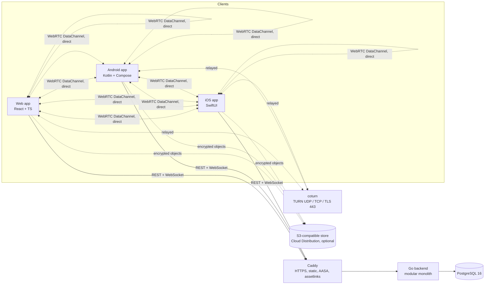

# Architecture

Source of truth for components, flows, the server data model, client-side storage, and client lifecycle behavior (including keeping the screen on). Product decisions live in `docs/PRODUCT_REQUIREMENTS.md` §2; endpoints and access levels in `docs/API.md`; security rules, lifetimes, and rate limits in `docs/SECURITY_MODEL.md`; screens in `docs/UX_SCREEN_MAP.md`.

Status: **planned**. Phases update this file as they implement each part and record deviations in `docs/ADR/`.

---

## 1. System overview



- **Backend** (`backend/internal`, eight packages max): `platform` (config, DB, HTTP, access-level and rate-limit middleware, logging, WebSocket hub and tickets), `devices` (anonymous identity, tokens, refresh rotation), `auth` (accounts layered on devices, ADK storage, history sync), `sharing` (sessions, participants, files, capabilities, join modes, protected mode), `transfers` (records and state machine), `signaling`, `turncreds`, `clipboard`.
- **Clients own the transfer engine**: chunking, hashing, flow control, bitmap resume, route selection, ETA, and the keep-awake controller. The backend authorizes, coordinates, and records.
- **Deployment**: one Docker Compose stack (Caddy, backend, PostgreSQL, coturn; MinIO only when Cloud is enabled). Single backend instance in MVP; rate-limit buckets live in process memory.

## 2. Platform building blocks

| Concern | Web | Android | iOS |
|---|---|---|---|
| UI | React, Tailwind, TanStack Query | Jetpack Compose, Material 3 | SwiftUI, `@Observable` |
| WebRTC | Browser APIs | `stream-webrtc-android` or `org.webrtc` (ADR) | `stream-webrtc-ios` or Google `WebRTC` xcframework (ADR) |
| Refresh secret | `HttpOnly` cookie | Keystore-backed encrypted storage | Keychain, `ThisDeviceOnly` |
| Local history | IndexedDB | Room | Core Data or GRDB (ADR; SwiftData needs iOS 17) |
| Resume bitmap | IndexedDB | Room | Sidecar file next to the partial download |
| Receive storage | File System Access API or OPFS + Service Worker download | SAF document or tree URI | App Documents (visible in Files) or a picked folder via security-scoped bookmark |
| Background transfers | Tab must stay open | Foreground service `dataSync` + partial wake lock + Wi-Fi lock | Not possible beyond ~30 s; checkpoint and resume on return |
| Keep screen on | Screen Wake Lock API | `FLAG_KEEP_SCREEN_ON` on the transfer screen window | `isIdleTimerDisabled` |
| Clipboard capture (Phase 5B) | Manual Sync with `readText()` in the click; automatic reads on focus / visibility only with permission already granted; in-page `copy` events; paste fallback (`docs/CLIPBOARD_PROTOCOL.md` §2.10) | `ClipboardManager` while an Activity is resumed (PRD §7.3, Phase 6) | `UIPasteboard` / `UIPasteControl` while active (PRD §7.3b, Phase 7) |
| Clipboard cache and offline queue | IndexedDB `share-anywhere-clipboard` (ciphertext only) | Room (Phase 6) | Core Data or GRDB (Phase 7) |

**Android client as built (Phase 6 milestone 6.1):** one Gradle module, `android/app` (`app.shareanywhere`, minSdk 26, targetSdk and compileSdk 35), Kotlin 2.2 with Jetpack Compose and Material 3, Hilt, Room, DataStore, Navigation Compose, OkHttp with kotlinx.serialization (`docs/ADR/0016-android-networking.md`, `0017-android-webrtc.md`, `0018-android-di-persistence-build.md`). Packages: `config` (BuildConfig values and feature flags `sharing`, `accounts`, `clipboard`, all off in 6.1), `data/api` (generated models and `ApiOperations` in `Api.gen.kt`, `ApiClient`, `DeviceApi`), `identity` (anonymous identity, proof of work, token claims, Keystore secret store), `history` (Room entity, DAO, repository, filters), `settings` (DataStore preferences), `di`, and `ui` (theme generated from `shared/design/tokens.json` into `ui/theme/Tokens.kt`; strings generated from the shared catalogs into `res/values` and `res/values-vi`; screens `welcome`, `home`, `history`, `devices`, `settings` named by their Screen Map IDs). The in-app language switch applies a localized configuration to the Compose tree; the theme follows the system or the Settings choice. Not built yet: Send and Receive, the transfer engine and keep-screen-on controller (the setting is stored, default on), the foreground service, accounts and Clipboard (milestones 6.2 to 6.4).

## 3. Identity flows

### 3.1 First launch (every client, no account)

```mermaid
sequenceDiagram
  participant App
  participant API as Backend
  App->>App: Show Welcome (first launch only)
  App->>API: POST /v1/devices/anonymous (platform, name, [PoW])
  API-->>App: device_id, access token (15 min), refresh secret
  App->>App: Store refresh secret securely; keep access token in memory
  App->>App: Start sharing → Transfer home
  Note over App,API: If bootstrap fails, Transfer home still opens with an inline retry
```

**As built (Phase 1, Web):** the app first tries `POST /v1/devices/token` with the `sa_device` cookie; a `401` means no identity yet, so it calls `POST /v1/devices/anonymous` with `transport: "cookie"`. A `428 pow_required` response carries a challenge that the client solves with Web Crypto SHA-256 and resends. Welcome is shown once per browser profile (a UI preference, not identity state). Identity status (loading, offline, rate limited with the `Retry-After` countdown, failed) is shown inline on Transfer home and Devices; navigation never waits for it (`web/src/lib/identity/identity.tsx`).

**As built (Phase 6 milestone 6.1, Android):** `IdentityManager` (`android/app/src/main/java/app/shareanywhere/identity/`) starts in the background whenever the app comes to the foreground (`ProcessLifecycleOwner`), never in front of the UI. With no stored secret it calls `POST /v1/devices/anonymous` with `transport: "body"` and platform `Android · <model>` (the server adds the two random words of the display name), solving a `428 pow_required` challenge with SHA-256 on `Dispatchers.Default` (the same base-36 counter as the Web, so both clients agree on test vectors). With a stored secret it refreshes instead. The access token is held only in memory; the refresh secret is written, before the new token is used, to `KeystoreSecretStore` (AES-256-GCM key in AndroidKeyStore, ciphertext in `noBackupFilesDir`, excluded from backups; `docs/ADR/0018-android-di-persistence-build.md`). Status (loading or solving, offline with Retry, rate limited with a countdown and automatic retry when `Retry-After` ends, failed with Retry) is shown inline on Transfer home and Devices (ON-2); Welcome is shown once (a DataStore flag) and navigation never waits for the identity.

### 3.2 Refresh

The client refreshes shortly before expiry with `POST /v1/devices/token`. The server rotates the secret; presenting an old secret revokes the device. Web sends the cookie plus `X-SA-Refresh: 1`.

**As built (Phase 1, Web):** `DeviceClient` (`web/src/lib/api/device-client.ts`) keeps the access token in memory, schedules a refresh 60 seconds before `expires_in` runs out, shares one in-flight refresh between callers, and refreshes then retries once when a request gets `401`. Refreshes run under the Web Locks API (`navigator.locks`, lock `sa-device-refresh`) so two tabs never present the same cookie at once, which would look like reuse and revoke the device. `POST /v1/devices/current/reset` revokes the device and returns a new identity with a new cookie. The server keeps an active-device check cached for 30 seconds per instance (`docs/ADR/0008-device-token-format.md`).

**As built (Phase 6 milestone 6.1, Android):** a refresh is scheduled 60 seconds before `expires_in` runs out, and any caller that finds the token within 5 seconds of expiry refreshes first. One mutex serializes refreshes and creation, so concurrent callers share one request and the process never presents the same secret twice. A request answered `401 device_token_expired` or `device_token_invalid` refreshes and retries once; other errors go back to the caller. A refresh answered `401 refresh_reused` drops the identity and creates a new one, and Transfer home and Devices say that the device got a new identity for safety; any other `401` on refresh (expired after 30 days, revoked) creates a new identity silently. Reset device identity (`POST /v1/devices/current/reset`) takes the new body-transport session the same way.

### 3.3 Sign in (optional, Phase 5A)

`POST /v1/auth/signin` is called with the current device token and the user's choices (`add_device`, `copy_history`). The device ID does not change, so running transfers continue. The next access token carries `acct` and `dl`. Sign-out removes the device from the account, revokes the account session, wipes ADK material, and returns a new anonymous identity.

```mermaid
sequenceDiagram
  participant App
  participant API as Backend
  App->>API: POST /v1/auth/signin (device token, email, password, add_device, copy_history)
  API->>API: Argon2id verify; insert auth_sessions (device_added); devices.kind = account if added
  API-->>App: access token with acct + dl, same device ID
  App->>API: POST /v1/devices/token (refresh, later)
  API-->>App: acct + dl re-derived from the live auth_sessions row
  App->>API: POST /v1/auth/signout
  API->>API: end session, device leaves account, revoke device
  API-->>App: brand-new anonymous identity (new cookie or refresh_secret)
```

**As built (Phase 5A, backend):** `backend/internal/auth` owns accounts, account sessions, the account Devices list, account keys, pairing, and history (`docs/API.md` §2.4). It is layered on `backend/internal/devices` without an import cycle: `devices` declares an `Accounts` interface (`AccountState(device)` for the live claims, `Refreshed(device, browserBinding)` on every refresh, which slides an added session and checks the `sa_acct` browser-session binding of a not-added Web session, `docs/ADR/0013-session-hardening.md`), `auth` implements it, and `cmd/server` wires it (`SetAccounts`), plus `OnRevoke` so a revoked identity also loses its account session. `devices.Service.Token` issues a token with the current claims after sign-in, sign-up, and Add this device; `devices.Service.Replace` revokes and recreates the identity at sign-out; `Forget` drops the cached account state on every change. Access levels are enforced by `backend/internal/platform/access` (`403 account_required`, `403 device_not_added`) and every account handler re-reads the live session, so a token minted before a revocation stops working at once. Key changes are authenticated by the ADK itself: the server stores each version's Ed25519 verify key, accepts a rotation only when signed by the current version and when its blobs go exactly to the other added devices proven at that version, and registers a device wrapping key only with a proof signed by the current version (`docs/ADR/0012-key-authenticity.md`, `docs/ADR/0014-current-version-proofs.md`). Every way a device leaves an account (revoke, sign-out, password reset and change, identity reset, refresh-secret reuse, expiry sweep, an unbound not-added Web session) runs through one function, `detach` in `backend/internal/auth/sessions.go`, which also sets `account_keys.rotation_due` when the leaving device had a registered key; `GET /v1/keys` reports it and the next successful rotation clears it. Session model and lifetimes: `docs/ADR/0010-account-sessions.md`, `docs/SECURITY_MODEL.md` §4. Password-reset mail goes through a `Mailer` adapter (console, SMTP for mailpit, in-memory for test stacks; `.env.example`). Not built yet: WebSocket `HISTORY_ENTRY_*` and `DEVICE_*` events (clients poll the history cursor).

**As built (Phase 5A, Web client):** the Web never sends `add_device: true` with the credentials: `/signin` and `/signup` sign in first (not added, so a mistaken click grants the least), then AC-4 asks for the two choices and calls `POST /v1/devices/current/add` with `copy_history` when the user keeps "Add this device" on (`docs/UX_SCREEN_MAP.md` §9). `DeviceClient` (`web/src/lib/api/device-client.ts`) takes the returned access tokens with `acceptToken` (same device ID, so transfers keep running) and sign-out's `DeviceSession` with `acceptSession` (new device ID and `sa_device` cookie); it retries a request after a refresh only on `401 device_token_invalid` / `device_token_expired`, never on answers such as `401 invalid_credentials`. It decodes the token's `acct` and `dl` claims for display state only and notifies listeners when they change. `web/src/features/account/AccountContext.tsx` derives the account state (guest; signed in, not added; signed in, added) and, for an added device, the key state from `GET /v1/keys` and the local key store: `setup` (account `key_version` 0, AC-5), `pair` (the account has a key this device lacks, AC-6), `ready`, `rejected` (an incoming key change did not verify, or the server reports an older key than this device holds), `refused` (the server refused this device's own rotation or key registration), or `legacy` (pre-release keys, `409 keys_legacy`). On every load and sign-in it accepts rotation blobs addressed to it only after verifying them (chain link to the held key and verify key; a blob that fails is neither stored nor acknowledged), acknowledges the stored ones (`DELETE /v1/keys/pending/{v}`), registers the device wrapping key (`PUT /v1/keys/device`) only once the device holds the ADK (after setup, pairing, or recovery, never right after Add this device) with a proof by the newest version it holds, and again whenever that version is newer than its registration (refreshing and retrying once on `409 key_version_conflict`), and imports older versions through the chain (`docs/CLIPBOARD_PROTOCOL.md` §1.13). A key check never erases keys because of what the server says about the same account (`key_version` 0 or lower than held gives `rejected`, keys kept). When the server reports `rotation_due` and the device is ready, the same key check rotates (wrapping only to devices proven at the current version, never to an excluded, just-revoked device); a failed rotation is account state (`rotationFailed`, Devices banner with Rotate keys) and is retried by every key check while the server keeps `rotation_due`. Key checks and rotations run one at a time (one queue in `keyFlow.ts`). Pairing and recovery on a device that already holds an ADK are anchored on the held keys. When the claims lose `acct` without this tab signing out (revoked from another device, password reset or change elsewhere, expiry), the client erases the key store and the sync bookkeeping; a non-secret `sa.pref.accountKeys` marker lets a guest load erase leftovers without loading the crypto code. Other tabs hear sign-in and sign-out on a `BroadcastChannel` and refresh. The key steps (`keyFlow.ts`) and history sync (`sync/historySync.ts`) load on demand with `web/src/lib/crypto`, outside the main bundle.

Cloud history sync (Web): each local entry is encrypted as JSON with the `history` subkey of the newest ADK (AAD `<entry_id>|<key_version>`) and posted under a deterministic `entry_id` (SHA-256 of `<local id>|<device id>`, shaped as a UUID), so a repeat is idempotent. Entries recorded after the device was added are uploaded while `history_sync` is on; older ones only by the one-time "Copy this device's transfer history" import. Pulls follow the `seq` cursor (`after=`), decrypt with the entry's own key version, and write `sync:<entry_id>` entries into the local History store with the origin device's name; tombstones delete the matching local entry. Deleting an entry or Clear all while syncing tombstones it on the server (`DELETE /v1/history/entries/{id}`, `DELETE /v1/history`), queued when offline. The cursor, the uploaded map and pending deletions live in the `share-anywhere-sync` IndexedDB database, never in Web Storage. Sync runs when the device becomes ready, when History opens, and every 30 s while the tab is visible.

**As built (Phase 5B, Web client): Clipboard Sync.** `ClipboardProvider` (`web/src/features/clipboard/ClipboardContext.tsx`, in the main bundle, inside the router) watches the account state; only when the `clipboard` and `accounts` flags are on, the account is signed in, this device is added, and its key state is `ready` does it import the runtime (`runtime.ts`, a lazy chunk with `engine.ts`, `store.ts`, `capture.ts`, and the crypto library). The runtime stops and is dropped as soon as any of that changes; `wipeAccountData` (sign-out, revoke, ended session, key wipe) also erases the IndexedDB clipboard store. Pieces:

- `engine.ts`: the decrypted timeline in memory, the cursor and cache in IndexedDB, the offline queue (encrypt → enqueue → send; idempotent by `event_id`; `409 key_version_conflict` → key check via `AccountContext.refreshKeys` → re-encrypt → retry once; `409 clipboard_paused` → paused; `413`/`400` → dropped; network errors → backoff), deletions and clear, settings, dedupe, and the sensitive-content skip (`sensitive.ts`).
- `capture.ts`: the only module that touches `navigator.clipboard`, the clipboard-read permission, and the page `copy` event; `status.ts` derives the capture status (`clipboardStatus`) from capability detection.
- `runtime.ts`: wires automatic capture (focus / visibility with permission `granted` and the per-browser toggle from `prefs.ts`, which is the only clipboard value in Web Storage), in-page copies, online/offline, device names (`GET /v1/devices`), and WebSocket messages: the provider subscribes to the shared `SessionSocket` while the runtime exists, and any `CLIPBOARD_*` message or a reconnect triggers a fetch by cursor; `CLIPBOARD_SETTINGS_UPDATED` is applied directly. A "New clipboard item from …" toast shows outside the Clipboard tab.
- Screens: `pages/ClipboardPage.tsx` (CB-1…CB-3 and key states, lazy) and `features/clipboard/ClipboardHome.tsx` (CB-4 and the CB-5 drawer, loaded only with the runtime), `pages/ClipboardSettingsPage.tsx` (CB-6). The main bundle grows only by the provider, the ST-1 section, and strings (CI budget 120 kB gzip).

### 3.4 WebSocket

`POST /v1/ws/ticket` → connect `/v1/ws?ticket=…` → server checks `Origin`, consumes the ticket, binds the socket to the device and account.

**As built (Phase 1):** `backend/internal/platform/ws`. The `Origin` check runs before the ticket is consumed and requires an exact match with `SA_ALLOWED_ORIGINS`; a missing `Origin` is accepted for native apps, which still need a ticket. Tickets are 24 random bytes, single use, 30 seconds. The first message is `WELCOME` with `server_time` (`shared/protocol/websocket-events.json`); the server pings every 25 seconds and closes with 1008 above 50 messages per second. Phase 1 defines no client-to-server messages; signaling arrives in Phase 2. The Web client does not open a socket until Phase 2 needs one. **Phase 5B:** the hub calls presence hooks when a device opens its first socket or closes its last one, asynchronously after `WELCOME` (the handshake never waits for them; best effort, details in §8); Clipboard Sync uses them for `DEVICE_CONNECTED` / `DEVICE_DISCONNECTED` (`docs/API.md` §4). Sockets stay bound to the device only: account events are addressed per device after checking the account session at send time (§8).

## 4. Share session and join flows

### 4.1 Create

Sender selects files → `POST /v1/sessions` with file metadata and `require_approval` (default `false`) → server returns a six-digit code, a link token, a QR payload, and `join_window_ends_at` (10 minutes later). The session is `WAITING` with an open join window; the sender's keep-awake controller becomes active (§7).

### 4.1b Join window

Code, link, and QR share one join window (`docs/SECURITY_MODEL.md` §3.0). The server checks the window on `resolve-code`, `resolve-link`, and `join`, and caps the join ticket at the window end. A background job and the `join` path both close the window when it times out, when the fifth receiver arrives, or on Stop accepting, and emit `SESSION_UPDATED`. `renew` (Create new code) replaces the code HMAC and the link token and opens a new window. Clients count down from `join_window_ends_at` using server time offsets from the API response, never only the local clock. Joined receivers, signaling, TURN, and transfers do not depend on the window.

**As built (Phase 2):** `backend/internal/sharing` (sessions, join window, participants, protected mode, jobs), `internal/signaling` (relay), `internal/turncreds`. Details:

- The code is stored as an HMAC (lookups) and also sealed with AES-256-GCM so that only the sender can see it again after a reload; the same holds for the link token. Neither is shown once the window is no longer open.
- `resolve-code` / `resolve-link` issue a single-use join ticket bound to the device and to the window's `join_window_seq`; Create new code increments the sequence and revokes old link tokens and tickets, so anything from the previous window fails at once.
- Window expiry is computed at request time (an open window past `join_window_ends_at` is treated as expired) and persisted by a maintenance job every 5 seconds, which also emits `SESSION_UPDATED`, expires idle (30 min with no connected participant) and over-age sessions, and purges ended sessions after 7 days.
- A removed, left, or rejected receiver may join again with a new valid ticket; a blocked one cannot (device ID and IP /64).
- Signaling: the WebSocket hub routes `OFFER`/`ANSWER`/`ICE_CANDIDATE` only between the sender and a `JOINED` receiver of a live session; anything else gets an `ERROR` reply. A device's sockets close when its identity is revoked.
- Test builds (`go build -tags testhooks`, used only by `docker-compose.ci.yml` with `SA_ENV=test`) add an adjustable clock (`POST /v1/_test/clock`), a protected-mode switch (`POST /v1/_test/protected-mode`), and a device lockout (`POST /v1/_test/lockout`, device level); production binaries contain none of them.
- Web: `web/src/features/sharing` (API, socket, participant card), `web/src/pages/send/SessionPage.tsx`, `web/src/pages/receive/*`, keep-awake controller in `web/src/lib/keepAwake`. Countdowns use the offset from `server_time`.

### 4.2 Open join (default)

```mermaid
sequenceDiagram
  participant R as Receiver
  participant API as Backend
  participant S as Sender
  R->>API: resolve-code or resolve-link
  API-->>R: Preview (sender name, badge, files) + join ticket
  R->>R: Tap Receive (Web: choose save target)
  R->>API: POST /sessions/{id}/join (ticket)
  API->>API: Lock session row, check slot, blocks, accepting
  API-->>R: Participant JOINED + security words
  API-->>S: PARTICIPANT_JOINED (name, badge, security words)
  S->>S: Toast / notification; Remove and Block available
  S-->>R: Signaling (OFFER / ANSWER / ICE) → transfer starts
```

### 4.3 Approval required, or protected mode for code joins

Same as above until `join`, which returns `REQUESTED`. The sender sees a request card with security words and approves, rejects, or blocks. On approval the participant becomes `JOINED` and signaling starts. Protected mode (`docs/SECURITY_MODEL.md` §3.1) forces this path for joins made with a six-digit code, in every session, while it is active.

### 4.4 Sender controls

Remove (revoke capabilities, close the peer connection, free the slot), Block (remove + refuse rejoin from device ID and IP /64), Stop accepting (ends the join window now), Create new code (new code, link, and QR with a fresh 10-minute window; old ones invalid), toggle Require approval (future joins only), Close session.

### 4.5 State machines

- Session: `CREATED → WAITING → ACTIVE → COMPLETED | PARTIALLY_COMPLETED | CLOSED | EXPIRED | CANCELLED`. `CLOSED` comes only from the sender's Close; `COMPLETED`, `PARTIALLY_COMPLETED`, and `EXPIRED` only from the idle or maximum lifetime, by delivery result (see *Session end and result* below).
- Join window: `OPEN → EXPIRED` (10 minutes) `| ENDED_FULL | ENDED_BY_SENDER`; `renew` from any of these except while full returns to `OPEN` with a new code. A session with an ended window and no receivers stays `WAITING` until the sender creates a new code, closes it, or it hits the idle or maximum lifetime.
- Participant: `REQUESTED` (approval path only) `→ JOINED → LEFT | REMOVED | BLOCKED`; `REQUESTED → REJECTED | BLOCKED`.
- Transfer (per file and receiver): `PENDING → CONNECTING → TRANSFERRING ⇄ PAUSED` (`PAUSED → COMPLETED` only from the receiver with every byte verified), `TRANSFERRING → DISCONNECTED → RECONNECTING → RESUMING → TRANSFERRING`, terminal `COMPLETED | FAILED | CANCELLED`.

All transitions are idempotent on the server and validated against the caller's role.

**Session end and result (as built, Phase 4 after QA; `backend/internal/sharing/aggregate.go`, `EndStatus`).**

- A live session (`WAITING` or `ACTIVE`) never ends by itself after delivering. Join window expiry, Stop accepting, Remove, Block, Reject, Leave, and final transfer reports leave it live, so the sender can tap Create new code (renew) whether the old window is still open or has ended and admit late receivers (PRD §3, `docs/SECURITY_MODEL.md` §3, `docs/UX_SCREEN_MAP.md` TR-4).
- Only two things end a live session: the sender's Close, which always records `CLOSED` whatever was delivered, and its idle (30 minutes with nobody connected) or maximum lifetime (24 h guest, 72 h account), enforced by the maintenance job.
- When a lifetime ends a session, the end status records the delivery result instead of always `EXPIRED`. It is computed under the session row lock, in the same transaction as the end, from the receivers and their transfers. Counted transfers belong to `JOINED` receivers and to receivers that `LEFT` on their own (one that left early did not get every file); `REMOVED` and `BLOCKED` receivers were excluded by the sender, so they count only if they had already received every file (a delivery the sender then cut off), and `REJECTED` and `REQUESTED` ones never had live transfers. `COMPLETED` when there is at least one counted transfer and all are `COMPLETED`; `PARTIALLY_COMPLETED` when at least one is `COMPLETED` (transfers still running when the lifetime cut them off count as not completed); otherwise `EXPIRED` (nothing delivered, including a `WAITING` session nobody joined).
- Ending (either way) sets `ended_at`, schedules the purge 7 days later, revokes every capability token, records a still-open join window as `ENDED_BY_SENDER`, and cancels unfinished transfers in the same transaction. Transfer records stay readable to the sender and joined receivers for the result screens. Participants get `SESSION_EXPIRED` (reason `idle` or `max_lifetime`) or `SESSION_CLOSED`; `SESSION_UPDATED` is not used to announce an end. The session view's `status` shows the recorded end status afterwards.
- The maintenance job, in order: expires join windows (never the session), ends idle and over-age sessions with their end status (counting `sa_sessions_completed_total` and `sa_sessions_partially_completed_total`), then cancels orphan transfers as `CANCELLED` (unfinished although their session ended or their receiver is no longer `JOINED`), so a session a lifetime just ended is fully cleaned up in the same tick.
- Lock order on every path: the session row before any transfer row. Transfer reports, sender controls, Leave, Close, and the lifetime end are therefore serialized per session: a final report either commits before the end reads the result or is refused after it (`409`: the transfer is already `CANCELLED`).
- Client result screens (TR-7, RX-7) are derived on each client from its own transfers (all completed, some completed, none), not from the session status, so they appear as soon as the client's transfers finish while the session itself stays live. The sender applies the same counting rule over the same unit, files (transfers): `finalOf` in `sender-controller.ts` gives completed when every counted file arrived and partial when some did, so a receiver that got one file of two makes the result partial on the sender, the receiver and the server alike. While the session is live its TR-7 result is provisional: it appears once every receiver has ended and at least one counts, clears when a later receiver joins (the dashboard returns), and the History entry (one per session) is rewritten whenever the result changes. Once the session has ended the result is final.
- A finished session that is still live holds one of the device's open-session slots (`docs/SECURITY_MODEL.md` §5) until Close or its idle or maximum lifetime, because the sender's open tab keeps it active. TR-7 "New transfer" therefore closes it first (confirming while the join window is open), and "Back to the session" leads to the code and Create new code instead. If the sender leaves another way and a later Create hits the cap (`409 too_many_open_sessions`), the send screen lists the device's open sessions (`GET /v1/sessions`) with Open and Close, so a slot can always be freed.

## 5. Transfer engine

Specified in `docs/TRANSFER_PROTOCOL.md` (Phase 3). Summary: 4 MiB blocks, 64 KiB frames, `bufferedAmountLowThreshold` backpressure, SHA-256 per block and per file, ACK after write and verify, persisted missing-block bitmap, resume by bitmap exchange, re-authentication with the transfer capability on every connect. One PeerConnection per receiver; a sender-side scheduler with a bounded block cache keeps a slow receiver from stalling the others (Phase 4).

## 6. Routes and TURN

The client picks the route per receiver: Direct P2P → TURN UDP → TURN TCP/TLS 443 → Cloud (signed-in sender, consented, within budget) → queue and retry. It observes `getStats()`, smooths with EWMA, applies hysteresis, and migrates by re-handshaking and exchanging the bitmap (Phase 8). `turncreds` issues coturn `use-auth-secret` HMAC credentials with username `expiry:participant_id` to the sender and `JOINED` receivers of an `ACTIVE` session: guest TTL 30 min, account 60 min, coturn `user-quota` 6, relay byte caps per session (`GUEST_RELAY_BYTES_CAP` 25 GB, `ACCOUNT_RELAY_BYTES_CAP` 100 GB) enforced by stopping renewal.

**As built (Phase 8).** *Route engine* (Web `web/src/features/transfer/engine/route.ts`, Android `transfer/engine/Route.kt`, iOS `ShareAnywhereCore/Sources/SATransferRuntime/Route.swift`, one set of vectors in `shared/protocol/schemas/route-vectors.json`): the classifier reads the selected candidate pair from `getStats()` (the transport's `selectedCandidatePairId`, else a `selected`/nominated-succeeded pair) and names it `direct`, `relay-udp`, `relay-tcp`, `relay-tls`, or `relay` (only the remote end relays); RTT comes from `currentRoundTripTime`. The receiver samples every 2 s (EWMA α 0.3 for RTT and verified throughput). Policy steps, receiver-driven: `all` → `relay-udp` → `relay-tls`. A stricter step dials relay-only (`iceTransportPolicy: relay`) with only that step's TURN URIs (`relay-udp`: `turn:` UDP; `relay-tls`: `turns:`, or TURN over TCP when no TLS URI is configured). Hysteresis: a step migrates only after 12 s without verified progress while connected, or two losses of *open* channels within 120 s on the same step; a migration starts a 30 s cooldown and the last step never migrates (the reconnect window then decides). A dial that never opens is not a loss (the sender may simply be away); two of them in a row on a stricter step return the receiver to its starting step (`RouteMonitor.reset`: the relay is unusable from here, as loopback TURN in Firefox). Migration is a new peer connection on the existing reconnect path (`docs/TRANSFER_PROTOCOL.md` §6), so the bitmap exchange resumes without resending verified blocks. A relayed connection is renewed on the same step when the TURN credential is within 2 minutes of expiry. The route badge shows Direct or Relay (`data-route-kind` carries the transport); the server records `direct`/`relay`/`cloud` per transfer for metrics (`sa_transfer_route_*_total`). *TURN* (ADR 0029): coturn serves UDP 3478 and TLS on its own port (443 on a separate address in production, 5349 in dev and CI); `turncreds` refuses renewal with `403 relay_cap_reached` once the session's relay bytes (coturn `prometheus-username-labels`: `turn_traffic_peer_sentb` + `turn_traffic_peer_rcvb` over the participants' usernames) reach the guest or account cap; an unreadable exporter fails open and is counted (`sa_turn_usage_unavailable_total`). Clients keep direct candidates and show `product.relay_cap_reached`. *Metrics*: the backend's internal listener `SA_METRICS_ADDR` serves `GET /metrics` (Prometheus text, aggregates only); CI scrapes it. *Cloud Distribution* (ADR 0030, `docs/TRANSFER_PROTOCOL.md` §9, `docs/API.md` §2.6): off unless `SA_CLOUD_ENABLED`; a signed-in, consented sender uploads client-side encrypted parts through the backend into an S3-compatible store (Versity Gateway in compose and CI, `--profile cloud` in dev); joined receivers (guests too) get the per-file key over signaling, wrapped to an ephemeral X25519 key, and fall back to the cloud when P2P is down; every byte counts against the sender's monthly budget, and objects are deleted after delivery, at the TTL, or when the session ends. On iOS a session sealed in the cloud is not paused when the app leaves the foreground, so receivers finish while it is suspended (PRD §2).

## 7. Client lifecycle and keeping the screen on

### 7.1 When the screen is kept on

A single **keep-awake controller** per client decides, from transfer and session state, whether to hold the screen on. It holds while any of these is true, the setting **Keep screen on during transfers** (default on, stored locally per device) is on, and the user has not tapped the screen-on pill off for the current transfer (that choice resets for the next session):

- the user is a sender whose session has an **open join window** (waiting for receivers, at most 10 minutes per window) or has transfers in progress;
- any transfer this device takes part in is `CONNECTING`, `TRANSFERRING`, `RESUMING`, `RECONNECTING`, or verifying, within the reconnect window (`docs/TRANSFER_PROTOCOL.md` §6: a peer gone for 10 minutes no longer holds the screen; on the Web a sender tab that lost its picked files after a reload cannot send and does not hold, and a tab that only mirrors another tab of the same browser holding the files (`docs/TRANSFER_PROTOCOL.md` §5.1) neither holds nor shows the keep-open banner, even with the join window open: the serving tab holds, and the mirroring tab asks the user to keep that tab open and in front, since a hidden tab's lock is released (§7.2));
- the user is a receiver waiting for approval (approval on or protected mode).

It releases as soon as none is true: every transfer is completed, failed, cancelled, or paused; the session is closed or expired; the join window ended with no transfer in progress; the receiver left or was removed; or the setting is turned off. Waiting for receivers therefore holds the screen for at most 10 minutes per join window.

### 7.2 Platform mechanics

| | Web | Android | iOS |
|---|---|---|---|
| Hold | `navigator.wakeLock.request('screen')` | `FLAG_KEEP_SCREEN_ON` on the Activity window (`View.keepScreenOn` from a Compose `DisposableEffect`) while a send, receive, or session screen is visible | `UIApplication.shared.isIdleTimerDisabled = true` while the scene is active |
| Release | `sentinel.release()` | Clear the flag | Set `isIdleTimerDisabled = false` |
| Visibility | The browser releases the lock when the tab is hidden; the controller listens for `release` and re-requests on `visibilitychange` → visible while still active | Flag only matters while the window is visible; leaving the screen clears it | Reset on `.background`, re-apply on `.active` |
| Screen turned off by the user | Transfer pauses if the browser suspends the tab (mobile); desktop continues | Foreground service keeps the transfer running, holding a `PARTIAL_WAKE_LOCK` and a Wi-Fi lock only while bytes move, released on pause or completion | App is suspended after ~30 s; checkpoint, local notification, resume on return |
| Not available | API missing or insecure context → pill state Unsupported (§7.3). No hidden-video hacks | — | — |
| Refused | `NotAllowedError` (battery saver, policy, hidden tab) → pill state Refused (§7.3); retry on the next visibility change or tap | — | — |

### 7.3 Keep-open banner and screen-on pill

Every send, receive, and waiting screen carries the sticky keep-open banner ("Keep Share Anywhere open — don't close it so the transfer continues.", keys `web.keep`, `android.keep`, `ios.keep`). The Web app registers a `beforeunload` confirmation while the controller is active; Android shows the same text in the foreground-service notification; iOS shows `ios.susp_h` ("Transfer paused — reopen the app to resume") with a local notification when the app is backgrounded.

The banner ends with the **screen-on pill**, the single component that shows keep-screen-on status on every platform (`docs/DESIGN_SYSTEM.md` §6). It is a toggle button with `aria-pressed`, an icon plus a label (never color only), and a hit area of at least 44 px / 48 dp / 44 pt. Its states:

| State | When | Icon | Label (catalog key, `<app>` = `web_xx`, `android_xx`, `ios_xx`) | Tap |
|---|---|---|---|---|
| On | Controller active, setting on, lock held | sun | "Screen stays on" (`<app>.wake_on`) | Turns it off for this transfer (next row) |
| Off for this transfer | User tapped the pill off; resets for the next session | sun-dim | "Screen can sleep" (`<app>.wake_off`) | Turns it back on |
| Paused or done | No active transfer and no open join window | sun-dim | "Screen can sleep — paused" (`<app>.wake_paused`) | Not interactive (`aria-disabled`) |
| Off in Settings | "Keep screen on during transfers" is off | sun-dim | "Screen-on is off in Settings" (`<app>.wake_setoff`) | Turns the setting back on |
| Unsupported (Web) | No Screen Wake Lock API or insecure context | eye, warning tint | "Your browser can't keep the screen on — keep this tab visible" (`web_xx.wake_unsup`) | Not interactive |
| Refused (Web) | `navigator.wakeLock.request` rejected (battery saver, policy, hidden tab) | eye, warning tint | "Couldn't keep the screen on — keep this tab visible" (`product.wake_refused`) | Retries the request |

Platform hints next to the banner: Android `product.hint_android_screen_off`, iOS `product.hint_ios_lock`.

## 8. Server data model

Implemented across Phases 1, 2, 5A, 5B, 8. Lifetimes and purge rules in `docs/SECURITY_MODEL.md` §6.

Core (guest and account):

- `devices(id, kind anonymous|account, user_id NULL, display_name, platform, refresh_transport cookie|body, refresh_generation, created_at, last_seen_at, expires_at, revoked_at)` with `CHECK ((kind = 'account') = (user_id IS NOT NULL))`. **Built in Phase 1** (`backend/migrations/0001_devices.sql`); `user_id` stays NULL until Phase 5A.
- `device_refresh_secrets(secret_hash PK, device_id → devices ON DELETE CASCADE, generation, created_at, used_at, retired)`: every issued refresh secret as a SHA-256 hash. A used secret keeps its row so reuse is detected; reuse revokes the device and deletes its rows. `retired` (migration 0007) marks a secret retired by the reuse-grace path, which never qualifies for grace itself. **Built in Phase 1.** Rotation locks the secret and the device rows (`SELECT … FOR UPDATE`) so two concurrent refreshes cannot both win.
- `share_sessions(id, owner_device_id NOT NULL, owner_user_id NULL, status, require_approval DEFAULT false, join_window_state OPEN|EXPIRED|ENDED_FULL|ENDED_BY_SENDER, join_window_seq, join_window_opened_at, join_window_ends_at, code_hmac, code_enc, link_enc, created_at, last_activity_at, expires_at, ended_at, purge_after)`. **Built in Phase 2** (`backend/migrations/0003_sharing.sql`), with a partial unique index on `code_hmac` where the window is open. `owner_user_id` is set only when the sender was signed in at creation and is used for Cloud and per-account limits, never required.
- `session_participants(id, session_id, device_id NOT NULL, user_id NULL, role sender|receiver, status, security_words, joined_via code|link, joined_at, decided_at)` with `UNIQUE (session_id, device_id)`.
- `session_blocks(session_id, device_id, ip_hash)` (`ip_hash` is an HMAC of the IPv4 address or IPv6 /64 with the server secret; addresses are never stored, migration 0004). Built in Phase 2, as are `session_participants` (plus `display_name`, `platform`, `signed_in`, `request_reason`, `ip_hash`), `shared_files`, `transfers` (created `PENDING` when a receiver becomes `JOINED`; reset to `PENDING` when a removed receiver rejoins; state machine and endpoints in `backend/internal/transfers`, Phase 3), `session_events`, and `capability_tokens` (purposes `join`, `join_ticket`, `transfer`; `window_seq`, `via`, `device_id`, `used_at`).
- `shared_files`, `transfers(participant_id, file_id, status, verified_bytes, route, …)`, `session_events`.
- `capability_tokens(id, session_id, participant_id NULL, purpose join|transfer, token_hash, expires_at, revoked_at)`.
- `protected_mode(active_until)` (single row) or an equivalent in-memory flag mirrored to metrics.

Account-only:

- `users`, `auth_sessions(id, user_id, device_id, device_added, created_at, last_used_at, expires_at, revoked_at)`, `password_resets`, `account_keys` (wrapped ADK per device, recovery-wrapped copy, `key_version`), `device_pairings`, `history_entries(id, user_id, origin_device_id, ciphertext, nonce, key_version, seq, created_at, deleted_at)`, `clipboard_events`, `clipboard_device_cursors`, `clipboard_settings`, `cloud_settings`, `cloud_objects`.
- **Built in Phase 5A** (`backend/migrations/0006_accounts.sql`):
  - `users(id, email, password_hash, history_sync, email_verified_at, created_at, password_changed_at)`: email lowercased (checked) with a unique index (plain `text`, since `citext` needs a database-wide extension); `email_verified_at` stays NULL in v1. `devices.user_id` references `users`; `devices.kind = 'account'` with `user_id` set exactly while the device is added to an account.
  - `auth_sessions` as above, with a partial unique index allowing one live (`revoked_at IS NULL`) session per device, plus `browser_binding` (migration 0007): the SHA-256 of the `sa_acct` cookie of a not-added Web session, NULL otherwise.
  - `password_resets(token_hash, user_id, created_at, expires_at, used_at)`.
  - `account_keys(user_id, key_version, recovery_public_key, recovery_salt, recovery_m, recovery_t, recovery_p, recovery_anchor, rotation_due, recovery_key_signature, updated_at)`, created with the user (`key_version = 0` until setup) and locked `FOR UPDATE` by setup and rotation; `account_key_versions(user_id, key_version, recovery_blob, chain_blob, verify_key, signature, created_by_device_id, created_at)` (no chain blob or signature for version 1). Per-device wrapped copies are not stored long-term: `device_keys(device_id, user_id, public_key, key_version, proof)` holds each added device's X25519 wrapping key with the proof that it holds ADK(`key_version`), and `device_key_blobs(device_id, key_version, user_id, blob, from_device_id)` holds rotation blobs until the device acknowledges them. Migration 0007 added `recovery_anchor`, `verify_key`, `signature`, `key_version`, and `proof`; rows from before it have NULL verify keys and anchor (legacy: rotation and registration answer `409 keys_legacy`), and unproven `device_keys` rows were deleted (`docs/ADR/0012-key-authenticity.md`). Since QA round 2 a registration is accepted only with a proof by the current version, and rotation requires blobs for exactly the other added devices whose `device_keys.key_version` equals the current version (`docs/ADR/0014-current-version-proofs.md`). `account_keys.rotation_due` (migration 0008) is set when an added device with a `device_keys` row leaves the account and cleared by a successful rotation. `account_keys.recovery_key_signature` (migration 0009, 64 bytes, NULL for accounts set up before it) is the setup signature by ADK(1) over the recovery public key, checked at setup and returned in `GET /v1/keys` (`docs/ADR/0015-authenticated-recovery-key.md`). A new `history_entries` row must carry the current `key_version`; the insert holds the `account_keys` row `FOR SHARE`.
  - `device_pairings(id, user_id, new_device_id UNIQUE, ephemeral_public_key, code_hash UNIQUE, created_at, expires_at, key_version, sender_public_key, blob, wrapped_by_device_id, wrapped_at, consumed_at)`.
  - `history_entries(user_id, entry_id, seq, origin_device_id, key_version, nonce, ciphertext, created_at, deleted_at)` with primary key `(user_id, entry_id)` (idempotent inserts), `UNIQUE (user_id, seq)`, and a check that tombstones carry no nonce or ciphertext. `origin_device_id` has no foreign key so history outlives purged device rows.
  - Leaving an account (sign-out, revoke, password reset or change, identity reset, refresh-secret reuse, expiry) deletes the device's `device_keys`, `device_key_blobs`, `device_pairings`, and (since Phase 5B) `clipboard_device_cursors` rows in the same transaction, after setting `account_keys.rotation_due` for the account when a `device_keys` row existed.
- **Built in Phase 5B** (`backend/migrations/0010_clipboard.sql`, `backend/internal/clipboard`; API in `docs/API.md` §2.5):
  - `clipboard_events(user_id, event_id, seq, origin_device_id, event_type 'TEXT', mime_type 'text/plain', key_version, nonce, ciphertext, payload_size, created_at, expires_at, deleted_at)` with primary key `(user_id, event_id)` (idempotent inserts), `UNIQUE (user_id, seq)`, checks on the v1 type and MIME type, a 12-byte nonce, ciphertext of 17–262,160 bytes, `payload_size` 1–262,144, and tombstones without nonce or ciphertext; partial indexes on live events by `(user_id, seq)` (history, cap), live events by `expires_at`, and tombstones by `deleted_at` (sweep). `origin_device_id` has no foreign key so events outlive purged device rows. `expires_at` is `created_at` plus the account's retention at insert.
  - `clipboard_settings(user_id, paused, retention_days 1–7, sensitive_skip, last_seq, updated_at)`: no row means the defaults (`false`, 7, `true`); the row is created by the first `PUT /v1/clipboard/settings` or the first clipboard write. `last_seq` is the highest clipboard `seq` ever assigned to the account. It is a column the frozen 5B contract did not list, added because the retention sweep hard-deletes rows: a `MAX(seq) + 1` sequence (as history uses) could reissue a `seq` that a device cursor has already passed after the highest rows were swept.
  - `clipboard_device_cursors(device_id → devices ON DELETE CASCADE, user_id, last_seq, updated_at)`: the cursor each device last reported with `GET /v1/clipboard/events` (upsert, never backwards, capped at the account's `last_seq`); deleted when the device leaves the account.
  - Event writes (create, delete, clear) take `pg_advisory_xact_lock(2, hashtext(user_id))`, then hold the `account_keys` row `FOR SHARE` and re-check the caller's account session (the lock every departure takes `FOR UPDATE`), then lock the `clipboard_settings` row and assign `seq` from `last_seq`; a new event must carry the current `key_version`. Inserting beyond 100 live events tombstones the oldest in the same transaction. Delete locks the target row `FOR UPDATE`; Clear locks the live rows it tombstones in a fixed order (`ORDER BY seq FOR UPDATE`) and renumbers exactly those rows. `PutSettings` does not take the advisory lock: it holds the `account_keys` row `FOR SHARE` (re-checking the session), then upserts the `clipboard_settings` row, the same order the event writes use after their advisory lock, so the two never wait on each other in a cycle. The cursor upsert in `GET /v1/clipboard/events` re-checks the session under the same key-row lock, so it cannot land after the device's departure deleted its cursor. The retention sweep runs from the account maintenance loop (`auth.Service.OnSweep`, every 5 minutes): it deletes live events past `expires_at` and tombstones older than 7 days in bounded batches (at most 500 rows per statement, 200 statements per kind per pass), each picking its rows in a fixed `(user_id, seq)` order with `FOR UPDATE SKIP LOCKED`. The sweep therefore never waits on a row lock and cannot deadlock with Clear, Delete, or Create; a row a write is holding is skipped and removed by a later pass if it still qualifies.
  - Event ids (`event_id`, like history's `entry_id`) are accepted only in the lowercase canonical 8-4-4-4-12 form, the exact text that goes into the AAD and that the server returns from its `uuid` column.
  - WebSocket: after each committed change the clipboard module sends metadata-only `CLIPBOARD_*` events through the hub to every open socket of the account's devices whose account session is live and added at send time; the hub's presence hook (`ws.Hub.OnPresence`, first socket opened or last socket closed) lets it send `DEVICE_CONNECTED` / `DEVICE_DISCONNECTED` to the account's other added devices (`docs/API.md` §4). Presence never runs on the handshake: the hub sends `WELCOME` first and queues the presence event to one of four workers (a device always maps to the same worker, so its connect and disconnect stay in order; each queue holds 256 events and a full queue drops the event with a log line); the clipboard hook bounds its session lookup and fan-out with a 5 s timeout.

Constraints:

- Atomic five-receiver cap: `SELECT … FOR UPDATE` on the session row, count `REQUESTED` + `JOINED` receivers, then insert.
- `REQUESTED` participants count toward the five receiver slots (so at most 5 can be waiting; the earlier "10 pending" figure could never apply).
- Six-digit code stored as an HMAC with a server pepper, unique among open join windows; link and QR join tokens are `capability_tokens` with `purpose = join` and `expires_at = join_window_ends_at`, revoked by `renew`.
- Capability tokens hashed at rest, single-purpose, expiring, revocable.
- Per-user `seq` for clipboard and history assigned under `pg_advisory_xact_lock(hashtext(user_id))` so `seq` order equals commit order. **As built (Phase 5A):** history uses the two-key form `pg_advisory_xact_lock(1, hashtext(user_id))` and assigns `MAX(seq) + 1` under it; a deletion moves the row to a new `seq` as a tombstone. **As built (Phase 5B):** clipboard uses `pg_advisory_xact_lock(2, hashtext(user_id))`, so the two sequences never wait on each other, and assigns `seq` from `clipboard_settings.last_seq` (never reused after the sweep).
- Idempotent state transitions; authorization on every resource; identities only from verified tokens.
