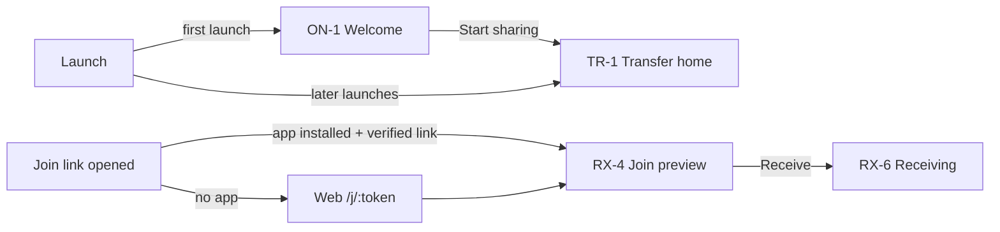

# UX Screen Map

Source of truth for every screen, how users reach it, and what guests and signed-in users see on it. Behavior and copy rules live in `docs/PRODUCT_REQUIREMENTS.md` §4, §5, §9; components and tokens in `docs/DESIGN_SYSTEM.md` (Phase 0). Phase 0 adds component references and per-screen state models; each implementing phase marks screens as built.

Status: **planned**; reconciled with the Claude Design handoff (commit 089e59c). Differences are listed in `docs/design/DESIGN_DEVIATIONS.md`.

---

## 1. Conventions

- **Destination** is one path string shared by the Web router, the Android navigation graph, and the iOS router, so deep links and tests use the same names. Web serves it as a URL; native apps map it to a route.
- **Design screen IDs** from `design/claude-design/` (Screen Map and each prototype's `startScreen` options) are the names used in code and tests: route names, component names, `data-screen` attributes, and test titles. §12 maps each row of this document to them per platform.
- **Guest** and **Signed in** say what each identity state sees. "Same" means no difference.
- Every screen implements the shared states where they apply: loading, empty, populated, error, offline, permission-denied, success, partial.
- No screen in the Onboarding, Transfer, Receive, History, or Settings areas may require an account. Account screens are reached only from the account CTAs in §9.
- Every send, receive, and active-session screen shows the **keep-open banner with the screen-on pill** (`docs/ARCHITECTURE.md` §7.3).

## 2. First-launch and entry paths

- Welcome appears once, on Web, Android, and iOS alike, and its only primary action opens Transfer home.
- A first-time visitor arriving through a join link skips Welcome and lands on the join preview.
- The anonymous device identity is created in the background on either path.

## 3. Onboarding

| ID | Screen | Destination | Guest | Signed in | Primary action |
|---|---|---|---|---|---|
| ON-1 | Welcome | `/welcome` | Value proposition, "No account needed to send or receive files", privacy line, optional "Already have an account? Sign in" link | Not shown (Welcome is first launch only) | Start sharing → TR-1 |
| ON-2 | Identity bootstrap error (inline on TR-1) | — | Inline card: offline, rate-limited with wait time, or proof-of-work in progress; Retry | Same | Retry |
| ON-3 | Permissions and privacy (education shown just in time, never on the first-launch path) | `/permissions` | Why notifications (and on mobile the camera) help, with Allow / Not now; denied state with how to change it in system settings | Same | Allow |

## 4. Transfer (send)

| ID | Screen | Destination | Guest | Signed in | Primary action |
|---|---|---|---|---|---|
| TR-1 | Transfer home | `/` | Send files, Receive files, active transfers, recent transfers from local history, header chip "Guest" + Sign in | Same, header chip shows account name | Send files / Receive files |
| TR-2 | Select files | `/send` | Web picker + drag-and-drop; Android SAF; iOS document picker | Same | Continue |
| TR-3 | Review selection | `/send` (same route once files are picked, as in the design's `send-review`) | Names, types, sizes, total; **Require approval** toggle (default off) with hint for sensitive files; Cloud option disabled with "Sign in to use Cloud transfer" (Phase 8). When Create hits the open-session cap, the device's open sessions are listed with Open and Close (`docs/ARCHITECTURE.md` §4.5) | Same, Cloud option enabled when consented (Phase 8) | Create session |
| TR-4 | Session: share and waiting | `/send/session/:id` | QR, six-digit code, and link sharing one join window with a countdown from **10:00**; receiver slots "0 of 5"; Require approval toggle; Stop accepting; keep-open banner and screen-on pill (not in a tab mirroring another tab, `docs/ARCHITECTURE.md` §7.1). **Expired state:** code, link, and QR hidden, "Code expired — Create new code" with the Create new code button; joined receivers keep transferring. **Full state:** "Session full", Create new code disabled until a slot frees | Same | Copy link / Create new code |
| TR-5 | Participants and requests | `/send/session/:id` (panel) | Joined receivers with name, platform, Guest/Signed in badge, security words, Remove, Block; when approval is on, request cards with Approve, Reject, Block; join toasts; Stop accepting nudge (`product.stop_nudge`); protected-mode notice when active | Same | Remove / Approve |
| TR-6 | Transfer dashboard | `/send/session/:id/transfers` | Per receiver and per file progress, speed, ETA with uncertainty, route badge, pause/resume/retry/cancel, error drawer, aggregate progress, keep-open banner and screen-on pill. **Another tab sends:** a tab of the same browser without the picked files, while another tab holds them, shows "Another tab of this browser is sending these files" (`product.tx_other_tab`) with progress from the server records (no speed or ETA), no keep-open banner or screen hold, no Pause or Resume (they steer the serving tab's connection; Remove, Block, Stop all and Close stay, being server actions), and never writes History (TR-4 shows the same notice) | Same | Stop all / Close session |
| TR-7 | Session result | `/send/session/:id/result` | Completed, partially completed, failed, cancelled; per-receiver summary; entry written to local history | Same, plus synced to cloud history when sync is on | Done / New session |
| TR-8 | Close or expire confirmation | dialog | Confirms ending the session and what happens to running transfers | Same | Close session |

## 5. Receive

| ID | Screen | Destination | Guest | Signed in | Primary action |
|---|---|---|---|---|---|
| RX-1 | Receive entry | `/receive` | Scan QR (camera permission asked just in time; simulator and desktop show code entry), enter code | Same | Scan / Enter code |
| RX-2 | Code entry | `/receive` (same Web screen as RX-1) | Six digits, validation, lockout message with wait time, "Code expired — ask the sender for a new code" (`common.cx_rx`) | Same | Continue |
| RX-3 | Web join page | `/j/:token` (share link and QR payload; also the Universal Link / App Link path) | Opens the app when installed and verified; otherwise the Web flow | Same | — |
| RX-4 | Join preview | `/join/preview` | Sender display name, Guest/Signed in badge, file names, sizes, count; browser capability check (Web); "Join within m:ss" in the last minute of the join window; expired message if the window ends before Receive; security words shown after joining | Same | Receive (Web: choose save target first) |
| RX-5 | Waiting for approval | `/receive/:sessionId` (state REQUESTED) | Only when approval is on or protected mode applies; security words; keep-open banner and screen-on pill | Same | Cancel |
| RX-5b | Save location | `/receive/:sessionId/save` | Web (Phase 3): the detected browser capability row (PRD §6.8) and warnings, security words, then Save to a folder (File System Access, Chromium), Keep in this browser then download (OPFS), or Keep in memory (only without OPFS, ≤ 256 MB); after a reload, a prompt to allow the remembered folder again; Android SAF folder (default Download); iOS Files location (default On My iPhone); storage-full error | Same | Start receiving |
| RX-6 | Receiving | `/receive/:sessionId` | Destination, per-file progress, verification, pause/resume/retry, keep-open banner and screen-on pill, iOS hint "Locking your iPhone pauses the transfer" | Same | Pause |
| RX-7 | Receive result | `/receive/:sessionId` (ended states) | Completed (SHA-256 verified), partial, failed, cancelled; Web: Download per file or "Saved in folder"; Android/iOS: open, share, or locate files; removed/blocked/code-expired/session-expired/session-full outcomes; entry written to local history | Same, plus cloud history when on | Open / Done |

## 6. History

| ID | Screen | Destination | Guest | Signed in | Primary action |
|---|---|---|---|---|---|
| HI-1 | History list | `/history` | Local entries only; banner "Stored only on this device" (`common.local`); once accounts exist, a Sign in action to sync history | Sync off: banner `product.turn_on_history_sync`. Sync on: merged local and synced entries with origin device | Search / Open entry |
| HI-2 | History detail | `/history/:entryId` | Direction, peer, files, transferred bytes vs size, result. Deleting an entry (or Clear all) also keeps that session from being recorded again for 7 days, so a live session that later finishes another delivery does not bring it back (Web, `history-store.ts`) | Same, plus origin device | Delete entry |

**As built (Phase 5A, Web):** banner by state (`web/src/features/account/SyncBanner.tsx`): offline at load in a browser that held account keys → neutral "Can't reach your account right now" line (never the guest prompt); guest "Sign in to sync your history across your devices" (Sign in, `returnTo=/history`); not added → Add this device; key check failed → error banner with Retry (re-runs the key check); a key change that could not be verified → error with **Pair again** / **Use recovery phrase**; this device's own key update refused by the server → "This device couldn't update your account keys" with the same two links; legacy pre-release keys → stated plainly; the account (`GET /v1/me`) failed to load → error banner with Retry (refetches it); sync off → `common.local` with **Turn on history sync**; key check running → "Checking this device's encryption key…"; account without a key → Set up encryption (AC-5); key missing here → Pair this device (AC-6); sync on → "Synced {when}" with Sync now, "Syncing…" only while a pass runs (nothing before the first pass or without a local history store), or an error banner with Retry (offline is said as such); entries the device cannot read yet are counted and pulled again once it gets the missing key version. Open tabs re-check the key when shown again and every 30 s (quietly, no "checking" state), and an upload refused because the account moved to a newer key runs a key check and retries once. Synced entries carry the origin device in HI-2 ("Device"). With sync on, Delete and Clear all also tombstone the synced copies, and the Clear dialog says so.

## 7. Devices

| ID | Screen | Destination | Guest | Signed in | Primary action |
|---|---|---|---|---|---|
| DV-1 | Devices | `/devices` | "This device" card (name, platform, anonymous since) with Rename and Reset device identity; account-required intro with Sign in / Create account | Device added: account device list, current device marked, Rename, Revoke, Pair a new device. Not added: read-only list + `product.add_device` | Rename / Sign in / Pair |
| DV-2 | Revoke confirmation | dialog | — | Explains loss of clipboard and history access and key rotation | Revoke |

**As built (Phase 5A, Web):** guests keep the "This device" card and get the "Sync your device list" intro with Sign in / Create account (`returnTo=/devices`). Signed in, `GET /v1/devices` lists the account's devices (current first, "This device" badge, platform and last activity, Trusted / Not trusted chip, "Not paired yet" for an added device without a registered key). An added device can rename any device (`PATCH /v1/devices/{id}`; its own name through `PATCH /v1/devices/current`), revoke another one (DV-2 lists: signed out of the account, loses synced history and clipboard, keys rotated, file sharing keeps working as a guest; then `DELETE /v1/devices/{id}` and the key rotation with the revoked device excluded, `409 devices_changed` / `key_version_conflict` refetch and retry once; a failed rotation shows a banner with "Rotate keys"; if another device already made the rotation, this one picks up its key and does not rotate again; if this device turns out to lack the newest key, a key check runs instead of the banner (it picks the key up or shows Pair). The revoked device stays excluded from this browser's later rotations until one that excluded it succeeds). When the server says a rotation is owed (`rotation_due`: a device holding the key left by any path), the key check of a ready device rotates by itself; if that fails the same banner shows, and it is retried on every key check until it goes through, and open **Pair a new device** (paste the new device's `sa1.…` code, or scan its QR where `BarcodeDetector` and a camera exist; the dialog names the waiting device before the key is sent). Revoke and pairing need this device's key (`ready`). A rotation is signed and wrapped only to devices whose key is proven by the current version and to a recovery key whose setup signature verifies with this device's own first key (`docs/CLIPBOARD_PROTOCOL.md` §1.13); a key change this device could not verify (or a server reporting an older key than this device holds, the keys are kept; or a recovery key that does not verify, nothing is sent) shows "A key change on your account could not be verified", and this device's own rotation or key registration refused by the server shows "This device couldn't update your account keys" (a device left behind by two rotations gets Pair instead), both with **Pair again** / **Use recovery phrase** (`/account/key/pair?mode=phrase`). A not-added device sees the list read-only (no Rename, Revoke or Pair; the server answers `PATCH /v1/devices/{id}` only for added devices) with `product.add_device` and **Add this device** (→ AC-4).

## 8. Settings

| ID | Screen | Destination | Guest | Signed in | Primary action |
|---|---|---|---|---|---|
| ST-1 | Settings | `/settings` | Header "Guest" + Sign in / Create account; device name; theme; language EN/VI; notifications; transfer strategy (Auto); **Keep screen on during transfers** (default on); data/battery; local history retention and Clear history; privacy; about. Cloud, history sync, clipboard, manage devices shown disabled with Sign in | Header with account name, Account/security, Sign out; all sections enabled | Sign in / toggle settings |

**As built (Phase 5A, Web):** guest header "Guest" with Sign in and Create account (`returnTo=/settings`), and an Account card with history sync, Manage devices and Cloud Distribution shown disabled ("Sign in to use Cloud transfer"). Signed in: the account email and initial, `product.add_device_clipboard` with **Add this device** while not added; for an added device the **Sync transfer history** switch (`PATCH /v1/me`, account-wide), the encryption-key state with Pair this device / Set up encryption when needed (or the "key change could not be verified" or "couldn't update your account keys" error with Pair again / Use recovery phrase), Manage devices, Cloud Distribution disabled until Phase 8, **Change password** (inline form, `POST /v1/me/password`; other devices are signed out) and **Sign out** (AC-7). A not-added device has no history sync switch or key row (`PATCH /v1/me` is for added devices only). Two-step verification is not built (`DESIGN_DEVIATIONS.md` A3).

## 9. Account (reached only from account CTAs)

Entry points: header chip and ST-1 Sign in, Clipboard intro (CB-1), Devices intro (DV-1), History banner (HI-1), Cloud option on TR-3. All return to the screen they came from (`returnTo`).

| ID | Screen | Destination | Shown when | Primary action |
|---|---|---|---|---|
| AC-1 | Sign in | `/signin` | Guest taps a CTA | Sign in |
| AC-2 | Create account | `/signup` | Guest taps Create account | Create account |
| AC-3 | Reset password | `/reset` | From AC-1 | Send link / Set password |
| AC-4 | After sign-in choices | `/signin/choices` | After AC-1 or AC-2 | `product.add_device` (on), `product.copy_history` (off) → Continue |
| AC-5 | Account Data Key setup | `/account/key/setup` | First device of a new account | Save recovery phrase → Continue |
| AC-6 | Pair this device | `/account/key/pair` | Added device without the ADK | Scan QR / paste pairing code, or Use recovery phrase |
| AC-7 | Sign out | dialog | From ST-1 | Keep local history / Clear local history → Sign out |
| AC-8 | You're set up (checklist) | `/account/checklist` | After the first sign-in on a device | Go to Clipboard |

**As built (Phase 5A, Web):** the account routes render outside the app shell (logo, language and theme, one card) and load on demand; every one of them keeps `returnTo`, which accepts only a same-origin relative path that is not itself an account route (`web/src/features/account/returnTo.ts`). Entry points: header chip (below 1100 px) and sidebar panel, Welcome's optional "Already have an account? Sign in", Settings, Devices, History banner.

- AC-1 / AC-2 sign in or create the account **without** adding the device; AC-4 follows. Client checks: email shape, password required (sign-up: at least 10 characters, strength meter); server errors are shown inline (`invalid_credentials`, `email_taken`, `weak_password`, rate limits with the wait). `already_signed_in` refreshes the token and returns.
- AC-3 request form → "Check your inbox" whatever the address; `/reset?token=` reads the token once, drops it from the address bar, and sets a new password (confirmation field); success links to Sign in.
- AC-4 (`trust`): device name, `product.add_device` (on) and, while it is on, `product.copy_history` (off) → Continue. Adding calls `POST /v1/devices/current/add`, then the key state routes to AC-5 (`key_version` 0), AC-6 (account key missing here) or AC-8. Not adding goes to AC-8.
- AC-5 (`key-setup`): the ADK and recovery phrase are prepared on the device (Argon2id in a Web Worker); the 12 words are shown once with the warning that losing every device and the phrase makes synced history unrecoverable; "I wrote down my recovery phrase" enables Continue, which sends `POST /v1/keys/setup` and only then stores the key. `409 keys_exist` points to AC-6.
- AC-6 (`key-pair`): QR plus copyable `sa1.<code>.<fingerprint>` text with the 10-minute countdown, polling every 2 s; expired or failed codes offer **New code**; a key from a sender that is not a device of the account, or one that does not match the account's signed key versions, is refused. **Use recovery phrase** (also opened directly with `?mode=phrase`): one field with word suggestions, unknown-word and checksum messages, word count, and progress while unlocking; a phrase of another account says so; a right phrase whose account keys do not verify stores nothing and says so. The device registers its wrapping key (with a proof) only after setup, pairing or recovery, never right after Add this device.
- AC-7: dialog from Settings with Keep / Clear local history; sign-out erases the key store and sync bookkeeping, the browser continues as a new guest (new device ID, no reload).
- AC-8 (`checklist`): sharing without an account, signed in as …, device added, key on this device, history sync on/off, each with its action when not done. **Continue** returns to `returnTo` and **Go to Clipboard** (design) opens Clipboard; when the flow started on Clipboard (`returnTo=/clipboard`) the only action is **Go to Clipboard** (Phase 5B).

## 10. Clipboard

| ID | Screen | Destination | Guest | Signed in | Primary action |
|---|---|---|---|---|---|
| CB-1 | Clipboard intro | `/clipboard` | Account-required intro: what it does, end-to-end encrypted, needs an account; Sign in / Create account. No clipboard access of any kind | — | Sign in |
| CB-2 | Add this device | `/clipboard` | — | Signed in, device not added | Add this device |
| CB-3 | Pairing needed | `/clipboard` | — | Device added, ADK missing → AC-6 | Pair |
| CB-4 | Clipboard home | `/clipboard` | — | History, Sync Clipboard (Web button, Android action, iOS `UIPasteControl`), capture status, auto-capture toggle (Web), search | Sync Clipboard |
| CB-5 | Item detail | `/clipboard/:eventId` | — | Full text, origin device, time, Copy, Delete | Copy |
| CB-6 | Clipboard settings | `/settings/clipboard` | Disabled with Sign in | Retention, pause sync, sensitive handling, clear history | Save |

**As built (Phase 5B, Web; `clipboard` flag on, needs `accounts`):** the Clipboard tab sits between Transfer and History. CB-1…CB-5 are one lazily loaded page; the runtime that touches the browser clipboard loads only for a ready account (signed in, device added, key held), so no other state makes a clipboard call (`docs/CLIPBOARD_PROTOCOL.md` §2.10).

- **CB-1** (guest): the design's intro (Clipboard Sync, what it does, the three points: encrypted end-to-end, you stay in control, why an account), `product.sign_in_clipboard`, **Sign in** / **Create account** with `returnTo=/clipboard`. No clipboard API call, permission query, or copy listener. Over plain HTTP it also says **HTTPS required**. While the device token is loading a skeleton shows; offline with an account marker the neutral "can't reach your account" line shows instead of the intro.
- **Signed in, not ready:** **HTTPS required** on plain HTTP; **CB-2** `product.add_device_clipboard` with **Add this device** (→ AC-4, back to Clipboard); key states: **Set up encryption** (no ADK yet, → AC-5), **CB-3** "Pair this device to use Clipboard Sync" with **Pair this device** / **Use recovery phrase** (→ AC-6), the key problem banners (`rejected`, `refused`, `legacy`, with Pair again / Use recovery phrase), storage unavailable, key check error with Retry; a skeleton while checking or loading the runtime, and an error with Retry if the runtime fails to load.
- **CB-4** (ready): header "Clipboard · Encrypted end-to-end · Text only" with **Clear history** (confirmation; deletes on every device). **Sync Clipboard** reads in the click; while reading it says "Reading clipboard…". Outcomes: toast "Clipboard synced · encrypted", or "Encrypted and queued" with its real cause (offline: "will send when online"; server busy `5xx`; rate limited `429`; key too old; sync paused), inline "Already synced", "Your clipboard has no text", "Too large to sync", "Resume sync first"; possibly sensitive text shows "Skipped as possibly sensitive" with the best-effort disclaimer, **Sync anyway** and **Don't sync**; a refused, unsupported or slow read opens the **paste fallback** (paste field and **Sync this text**; "Clipboard permission denied" with the site-settings hint when denied). The **capture status panel** shows the `clipboardStatus` state with its title and explanation, **Pause sync** / **Resume sync** (account-wide) and the **Automatic capture when permitted** switch (this browser). In-page copies are captured only while the panel says `auto` or `besteffort` with the switch on, never when it says capture is manual (`unsupported`, `denied`, switch off) or `paused`. Pause, Resume, the filter chips and the skipped-row dismiss button are at least 44 px below the `rail` breakpoint. Banners: load failed with items shown (Retry), offline with cached items, settings failed (Retry), send failed (Retry), key too old to send (Pair again), rate limited, item refused as too large. Search, filter chips (All, From this browser, From other devices, Links), the timeline (newest first; origin device name or "This browser", relative time, **New** for items from other devices not copied yet, **Queued**, locked rows "Locked on this device"), **Copy** per row, notes skipped as sensitive by automatic capture (dismissable), empty state (only after a successful load), offline state (first load offline with nothing cached: "You're offline", loads on reconnect, syncs are queued), load-error state (nothing cached, Retry), no-match state, loading skeleton (also while the first load runs with nothing cached), and the retention line with a link to CB-6.
- **CB-5** `/clipboard/:eventId`: drawer with origin device, date and time, full text, character count, "Encrypted end-to-end", **Copy** (writeText, then the selection fallback, then "Couldn't copy automatically. The text is selected") and **Delete** (on every device). Escape or the scrim closes it; a link to a gone item falls back to the list.
- **CB-6** `/settings/clipboard`: automatic capture (this browser), skip sensitive content (with the disclaimer), pause Clipboard Sync, keep items (7 days, 3 days, 1 day; 100 items max), clear history. Guests see every control disabled with Sign in; a signed-in device that is not ready sees them disabled with a link to Clipboard. ST-1 has a Clipboard section: disabled rows with "Needs sign-in" for guests, a **Clipboard settings** link when signed in.

## 11. Platform differences

| Topic | Web | Android | iOS |
|---|---|---|---|
| Navigation | Sidebar (desktop), compact bar (small screens) | Bottom navigation | `TabView` with `NavigationStack` per tab |
| Welcome | Route shown once | Shown once before the start destination | Full-screen cover shown once |
| Account screens | Routes | Nested graph | Sheet |
| Clipboard tab before Phase 5B | Hidden by the `clipboard` flag | Hidden | Hidden |
| Screen-on pill | Wake Lock states, including unsupported and refused | Hint `product.hint_android_screen_off` | Hint `product.hint_ios_lock` |
| QR scan | Not offered; code entry and links cover Web | CameraX | AVFoundation + Vision (real device only) |

**As built (Phase 6 milestone 6.1, Android):** ON-1 `welcome` (shown once, Start sharing → TR-1, no sign-in), TR-1 `home` (logo, ON-2 identity notices, recent local transfers with See all, empty and loading states; Send and Receive arrive in 6.2), HI-1 `history` (search, the design's chips plus status, date and device filters, `common.local` banner, empty, no-match, loading and error states, Clear history with confirmation) with HI-2 as a bottom sheet tagged `history-detail` (Delete from history), DV-1 `devices` ("This device" card with name, platform, Anonymous since, Rename, Reset device identity), ST-1 `settings` (Guest header, theme, language System/English/Tiếng Việt, Keep screen on during transfers, Keep transfer history 30/90 days/don't keep, Clear history, privacy note, version). Bottom navigation Transfer, History, Devices, Settings; Clipboard hidden by its flag. Screen IDs are the navigation routes and Compose test tags. Differences from the design: `docs/design/DESIGN_DEVIATIONS.md` section I.

**As built (Phase 6 milestone 6.2, Android):** Transfer home shows the Send files and Receive files tiles. TR-2/TR-3 `send` (SAF multi-select, file rows with remove, Add more, total, Require approval default off, Create share session; over-limit and unreadable-file states; the open-session list on `too_many_open_sessions`). TR-4/TR-5 `session` / `session-expired` (QR at level H, six-digit code, Copy and Share, 10:00 countdown on the server clock with TalkBack announcements at 1:00 and 0:10, Stop accepting, "Code expired — Create new code", Session full, Require approval, capacity bar, request cards with Approve/Reject/Block, participant cards with Guest/Signed in badge, security words, Remove and Block with confirmation, protected-mode notice, keep-open banner with the screen-on pill while the window is open, TR-8 close sheet, ended state). Joins and requests show a snackbar, or a local notification while the app is in the background (notification permission asked on `session`). RX-1/RX-2 `receive` / `receive-code` (Scan tab with CameraX viewfinder, torch, camera ask/denied/unavailable states; Enter code tab with six boxes, paste, lookup errors including lockout wait). RX-3 App Links (`<SA_PUBLIC_URL>/j/<token>`, `docs/runbooks/android-app-links.md`). RX-4 `rx-preview`, RX-5 `rx-wait` (screen kept on, Cancel request, declined outcome), the joined receiver (`rx-save`, files pending until 6.3) and RX-7 `rx-done` outcomes (removed, blocked, left, closed, ended). Differences: `docs/design/DESIGN_DEVIATIONS.md` section J.

**As built (Phase 6 milestone 6.3, Android):** transfers run on the Kotlin engine (`transfer/engine`, byte for byte the Web's protocol) over WebRTC. RX-5b `rx-save` (Download/Share Anywhere preselected, Choose folder, security words, files), RX-6 `rx-progress` (keep-open banner with screen-on pill and `product.hint_android_screen_off`, route chip, progress ring, speed and ETA, folder, reconnecting notice, unreachable with Retry, per-file bars, Pause/Resume, Cancel with confirmation), RX-7 `rx-done` (completed with SHA-256 line, partial, failed with the error, cancelled; per-file Open and Share; Done). TR-5 participant cards show each receiver's transfer line and the session screen offers Open dashboard; TR-6 `dashboard` and TR-7 `dashboard-done` / `dashboard-partial` (overall progress and group ETA, receiver cards with route, status, speed and ETA, Pause/Resume/Cancel, Stop all, result, Done). A `dataSync` foreground service keeps transfers going with the screen off (`docs/ADR/0020-android-background-transfers.md`).

## 12. Design screen IDs, components, and state models

Web IDs come from `Web App.dc.html`, Android IDs from `Android App.dc.html`, iOS IDs from `iOS App.dc.html`. "—" means the platform has no separate screen. Components are named in `docs/DESIGN_SYSTEM.md` §6.

| Row | Web ID | Android ID | iOS ID | Main components | State model (design prototype states) |
|---|---|---|---|---|---|
| ON-1 Welcome | `welcome` | `welcome` | `welcome` | Logo lockup, Button lg "Start sharing" | default |
| ON-2 Identity bootstrap error | `home` (inline) | `home` | `home` | Permission/offline banner | `homeState`: `offline`, `loading` |
| ON-3 Permissions and privacy (just in time, not on the first-launch path) | `perms` | `perms` | system prompt | Permission banner, system dialog | `notifPermission`: `ask`, `granted`, `denied` |
| TR-1 Transfer home | `home` | `home` | `home` | Hero Send/Receive buttons, active transfer card, recent list, empty state, skeleton | `homeState`: `active`, `new`, `loading`, `offline` |
| TR-2 Select files | `send` | `send` | `send` | Drop zone / picker, File row | empty, picking, picked, error |
| TR-3 Review selection | `send-review` | `send` | `send` | File row list, total, Require approval switch; open-sessions panel (Web, deviation E16) | default, offline, open-session cap reached (`too_many_open_sessions`: the device's open sessions listed with Open and Close, `GET /v1/sessions`) |
| TR-4 Session share and waiting | `session`, `session-full`, `session-expired` | `session`, `session-expired` | `session`, `session-expired` | QR panel, six-digit code, 10:00 countdown, Capacity, Keep-open banner, Screen-on pill | open window, under one minute, `session-expired` (window ended, replaced, or Stop accepting), `session-full`, `wakeLock`: `auto`, `unsupported` |
| TR-5 Participants and requests | `session` panel, `session-approved` | `session` (`approval=1`) | `session-approval` | Participant card, Security words, toast | auto-joined, pending request, approved, rejected, removed, blocked, protected mode |
| TR-6 Transfer dashboard | `dashboard` | `dashboard` | `dashboard`, `suspended` | Progress bar/ring, Route badge, Status chip, Files × receivers matrix, connection-log drawer/sheet, Keep-open banner, Screen-on pill | per receiver: waiting (has not chosen where to save), connecting, transferring, paused, reconnecting, offline (gone past the 10-minute reconnect window, G14), verifying, completed, failed, removed, cancelled, budget; iOS `suspended` |
| TR-7 Session result | `dashboard-done`, `dashboard-partial` | `dashboard-done`, `dashboard-partial` | `dashboard-done`, `dashboard-partial` | Status chip, summary | completed, partial, failed, cancelled |
| TR-8 Close session dialog | `dashboard` dialog | sheet | alert | Dialog / bottom sheet | default |
| RX-1 Receive entry | `receive` | `receive` (scan) | `receive` (scan) | QR scanner (native), code input | camera denied, scanning |
| RX-2 Code entry | `receive` | `receive-code` | `receive-code` | OTP six-digit input | default, error not found, code expired, locked out |
| RX-3 Web join page | `receive-preview` from a link | App Link | Universal Link | — | — |
| RX-4 Join preview | `receive-preview` | `rx-preview` | `rx-preview` | Sender card, File row list, total | default, join window under one minute, expired |
| RX-5 Waiting for approval | `receive-wait` (also the declined outcome) | `rx-wait` | `rx-wait` | Security words, Keep-open banner, Screen-on pill | `receiveOutcome`: `approved`, `rejected`, `expired` |
| TR-4b Session ended (Web addition) | `session-ended` | — | — | Heading, New session | closed, expired |
| RX-5b Save location | `receive-save` | `rx-save` | `rx-preview` (Save to Files) | Folder picker, large-file warning | default, `rxIssue`: `storage` |
| RX-6 Receiving | `receive-progress` | `rx-progress` | `rx-progress` | Progress, Status chip, Keep-open banner, Screen-on pill | receiving, reconnecting, verifying, paused in background (iOS) |
| RX-7 Receive result | `receive-done` (also removed, blocked, left, closed, expired outcomes) | `rx-done` | `rx-done` | Status chip, Open / Share / Show in folder | completed, `rxIssue`: `checksum`, `partial` |
| HI-1, HI-2 History | `history` | `history` | `history` | Tabs, search and filter bar, list, empty state, clear dialog | empty, populated, no match, cleared |
| DV-1, DV-2 Devices | `devices` | `devices` | `devices` | This device card, device list, rename sheet, revoke dialog | guest, signed in |
| ST-1 Settings | `settings` | `settings` | `settings` | Grouped list, pickers, Switch | guest, signed in |
| AC-1 Sign in | `signin` | `signin` | `signin` | Input, Button | default, error |
| AC-2 Create account | `signup` | `signup` | `signup` | Input with password strength | default, error |
| AC-3 Reset password | `forgot` | `forgot` | `forgot` | Input, sent state | form, sent |
| AC-4 After sign-in choices / trust device | `trust` | trust step | trust step | Switch, Button | default (the design's `verify` email step is not built, `DESIGN_DEVIATIONS.md` A1) |
| AC-5 Account Data Key setup (Web addition, `DESIGN_DEVIATIONS.md` E17) | `key-setup` | — | — | Recovery-phrase grid, warning, checkbox, Button | generating, phrase shown, keys exist, unavailable, error |
| AC-6 Pair this device / recovery phrase (Web addition, E17) | `key-pair` | — | — | QR panel, code text, countdown, phrase field with suggestions | waiting, expired, failed, untrusted, phrase (invalid word, checksum, wrong phrase, unlocking) |
| AC-7 Sign out | `settings` dialog | — | — | Dialog with Segmented keep / clear | default |
| AC-8 First-run checklist after sign-in | `checklist` | `checklist` | `checklist` | Checklist | default |
| CB-1 to CB-6 Clipboard | `clipboard` (CB-1…CB-5; CB-6 `clipboard-settings`, a Web addition) | `clipboard` | `clipboard` | Account-required intro, Sync Clipboard / PasteButton, capture status panel, paste fallback (Web), sensitive-skip banner, timeline, item detail drawer, clear dialog | Web `clipboardStatus`: `auto`, `besteffort`, `denied`, `unsupported`, `offline`, `paused`, plus `insecure` (plain HTTP, "HTTPS required"; Web addition); timeline: loading, empty, offline (nothing cached), error (nothing cached), populated, no match, queued, locked, new; Android: `foreground`, `offline`, `paused`, `error`; iOS: `manual`, `offline`, `paused`, `denied` |
