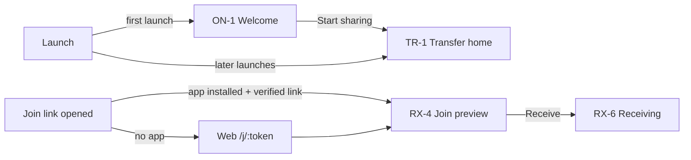

# UX Screen Map

Source of truth for every screen, how users reach it, and what guests and signed-in users see on it. Behavior and copy rules live in `docs/PRODUCT_REQUIREMENTS.md` §4, §5, §9; components and tokens in `docs/DESIGN_SYSTEM.md` (Phase 0). Phase 0 adds component references and per-screen state models; each implementing phase marks screens as built.

Status: **planned**; reconciled with the Claude Design handoff (commit 089e59c). Differences are listed in `docs/design/DESIGN_DEVIATIONS.md`.

---

## 1. Conventions

- **Destination** is one path string shared by the Web router, the Android navigation graph, and the iOS router, so deep links and tests use the same names. Web serves it as a URL; native apps map it to a route.
- **Design screen IDs** from `design/claude-design/` (Screen Map and each prototype's `startScreen` options) are the names used in code and tests: route names, component names, `data-screen` attributes, and test titles. §12 maps each row of this document to them per platform.
- **Guest** and **Signed in** say what each identity state sees. "Same" means no difference.
- Every screen implements the shared states where they apply: loading, empty, populated, error, offline, permission-denied, success, partial.
- No screen in the Onboarding, Transfer, Receive, History, or Settings areas may require an account. Account screens are reached only from the account CTAs in §9.
- Every send, receive, and active-session screen shows the **keep-open banner with the screen-on pill** (`docs/ARCHITECTURE.md` §7.3).

## 2. First-launch and entry paths

- Welcome appears once, on Web, Android, and iOS alike, and its only primary action opens Transfer home.
- A first-time visitor arriving through a join link skips Welcome and lands on the join preview.
- The anonymous device identity is created in the background on either path.

## 3. Onboarding

| ID | Screen | Destination | Guest | Signed in | Primary action |
|---|---|---|---|---|---|
| ON-1 | Welcome | `/welcome` | Value proposition, "No account needed to send or receive files", privacy line, optional "Already have an account? Sign in" link | Not shown (Welcome is first launch only) | Start sharing → TR-1 |
| ON-2 | Identity bootstrap error (inline on TR-1) | — | Inline card: offline, rate-limited with wait time, or proof-of-work in progress; Retry | Same | Retry |
| ON-3 | Permissions and privacy (education shown just in time, never on the first-launch path) | `/permissions` | Why notifications (and on mobile the camera) help, with Allow / Not now; denied state with how to change it in system settings | Same | Allow |

## 4. Transfer (send)

| ID | Screen | Destination | Guest | Signed in | Primary action |
|---|---|---|---|---|---|
| TR-1 | Transfer home | `/` | Send files, Receive files, active transfers, recent transfers from local history, header chip "Guest" + Sign in | Same, header chip shows account name | Send files / Receive files |
| TR-2 | Select files | `/send` | Web picker + drag-and-drop; Android SAF; iOS document picker | Same | Continue |
| TR-3 | Review selection | `/send` (same route once files are picked, as in the design's `send-review`) | Names, types, sizes, total; **Require approval** toggle (default off) with hint for sensitive files; Cloud option disabled with "Sign in to use Cloud transfer" (Phase 8) | Same, Cloud option enabled when consented (Phase 8) | Create session |
| TR-4 | Session: share and waiting | `/send/session/:id` | QR, six-digit code, and link sharing one join window with a countdown from **10:00**; receiver slots "0 of 5"; Require approval toggle; Stop accepting; keep-open banner and screen-on pill. **Expired state:** code, link, and QR hidden, "Code expired — Create new code" with the Create new code button; joined receivers keep transferring. **Full state:** "Session full", Create new code disabled until a slot frees | Same | Copy link / Create new code |
| TR-5 | Participants and requests | `/send/session/:id` (panel) | Joined receivers with name, platform, Guest/Signed in badge, security words, Remove, Block; when approval is on, request cards with Approve, Reject, Block; join toasts; Stop accepting nudge (`product.stop_nudge`); protected-mode notice when active | Same | Remove / Approve |
| TR-6 | Transfer dashboard | `/send/session/:id/transfers` | Per receiver and per file progress, speed, ETA with uncertainty, route badge, pause/resume/retry/cancel, error drawer, aggregate progress, keep-open banner and screen-on pill | Same | Stop all / Close session |
| TR-7 | Session result | `/send/session/:id/result` | Completed, partially completed, failed, cancelled; per-receiver summary; entry written to local history | Same, plus synced to cloud history when sync is on | Done / New session |
| TR-8 | Close or expire confirmation | dialog | Confirms ending the session and what happens to running transfers | Same | Close session |

## 5. Receive

| ID | Screen | Destination | Guest | Signed in | Primary action |
|---|---|---|---|---|---|
| RX-1 | Receive entry | `/receive` | Scan QR (camera permission asked just in time; simulator and desktop show code entry), enter code | Same | Scan / Enter code |
| RX-2 | Code entry | `/receive` (same Web screen as RX-1) | Six digits, validation, lockout message with wait time, "Code expired — ask the sender for a new code" (`common.cx_rx`) | Same | Continue |
| RX-3 | Web join page | `/j/:token` (share link and QR payload; also the Universal Link / App Link path) | Opens the app when installed and verified; otherwise the Web flow | Same | — |
| RX-4 | Join preview | `/join/preview` | Sender display name, Guest/Signed in badge, file names, sizes, count; browser capability check (Web); "Join within m:ss" in the last minute of the join window; expired message if the window ends before Receive; security words shown after joining | Same | Receive (Web: choose save target first) |
| RX-5 | Waiting for approval | `/receive/:sessionId` (state REQUESTED) | Only when approval is on or protected mode applies; security words; keep-open banner and screen-on pill | Same | Cancel |
| RX-5b | Save location | `/receive/:sessionId/save` | Web (Phase 3): the detected browser capability row (PRD §6.8) and warnings, security words, then Save to a folder (File System Access, Chromium), Keep in this browser then download (OPFS), or Keep in memory (only without OPFS, ≤ 256 MB); after a reload, a prompt to allow the remembered folder again; Android SAF folder (default Download); iOS Files location (default On My iPhone); storage-full error | Same | Start receiving |
| RX-6 | Receiving | `/receive/:sessionId` | Destination, per-file progress, verification, pause/resume/retry, keep-open banner and screen-on pill, iOS hint "Locking your iPhone pauses the transfer" | Same | Pause |
| RX-7 | Receive result | `/receive/:sessionId` (ended states) | Completed (SHA-256 verified), partial, failed, cancelled; Web: Download per file or "Saved in folder"; Android/iOS: open, share, or locate files; removed/blocked/code-expired/session-expired/session-full outcomes; entry written to local history | Same, plus cloud history when on | Open / Done |

## 6. History

| ID | Screen | Destination | Guest | Signed in | Primary action |
|---|---|---|---|---|---|
| HI-1 | History list | `/history` | Local entries only; banner "Stored only on this device" (`common.local`); once accounts exist, a Sign in action to sync history | Sync off: banner `product.turn_on_history_sync`. Sync on: merged local and synced entries with origin device | Search / Open entry |
| HI-2 | History detail | `/history/:entryId` | Direction, peer, files, transferred bytes vs size, result | Same, plus origin device | Delete entry |

## 7. Devices

| ID | Screen | Destination | Guest | Signed in | Primary action |
|---|---|---|---|---|---|
| DV-1 | Devices | `/devices` | "This device" card (name, platform, anonymous since) with Rename and Reset device identity; account-required intro with Sign in / Create account | Device added: account device list, current device marked, Rename, Revoke, Pair a new device. Not added: read-only list + `product.add_device` | Rename / Sign in / Pair |
| DV-2 | Revoke confirmation | dialog | — | Explains loss of clipboard and history access and key rotation | Revoke |

## 8. Settings

| ID | Screen | Destination | Guest | Signed in | Primary action |
|---|---|---|---|---|---|
| ST-1 | Settings | `/settings` | Header "Guest" + Sign in / Create account; device name; theme; language EN/VI; notifications; transfer strategy (Auto); **Keep screen on during transfers** (default on); data/battery; local history retention and Clear history; privacy; about. Cloud, history sync, clipboard, manage devices shown disabled with Sign in | Header with account name, Account/security, Sign out; all sections enabled | Sign in / toggle settings |

## 9. Account (reached only from account CTAs)

Entry points: header chip and ST-1 Sign in, Clipboard intro (CB-1), Devices intro (DV-1), History banner (HI-1), Cloud option on TR-3. All return to the screen they came from (`returnTo`).

| ID | Screen | Destination | Shown when | Primary action |
|---|---|---|---|---|
| AC-1 | Sign in | `/signin` | Guest taps a CTA | Sign in |
| AC-2 | Create account | `/signup` | Guest taps Create account | Create account |
| AC-3 | Reset password | `/reset` | From AC-1 | Send link / Set password |
| AC-4 | After sign-in choices | `/signin/choices` | After AC-1 or AC-2 | `product.add_device` (on), `product.copy_history` (off) → Continue |
| AC-5 | Account Data Key setup | `/account/key/setup` | First device of a new account | Save recovery phrase → Continue |
| AC-6 | Pair this device | `/account/key/pair` | Added device without the ADK | Scan QR / paste pairing code, or Use recovery phrase |
| AC-7 | Sign out | dialog | From ST-1 | Keep local history / Clear local history → Sign out |
| AC-8 | You're set up (checklist) | `/account/checklist` | After the first sign-in on a device | Go to Clipboard |

## 10. Clipboard

| ID | Screen | Destination | Guest | Signed in | Primary action |
|---|---|---|---|---|---|
| CB-1 | Clipboard intro | `/clipboard` | Account-required intro: what it does, end-to-end encrypted, needs an account; Sign in / Create account. No clipboard access of any kind | — | Sign in |
| CB-2 | Add this device | `/clipboard` | — | Signed in, device not added | Add this device |
| CB-3 | Pairing needed | `/clipboard` | — | Device added, ADK missing → AC-6 | Pair |
| CB-4 | Clipboard home | `/clipboard` | — | History, Sync Clipboard (Web button, Android action, iOS `UIPasteControl`), capture status, auto-capture toggle (Web), search | Sync Clipboard |
| CB-5 | Item detail | `/clipboard/:eventId` | — | Full text, origin device, time, Copy, Delete | Copy |
| CB-6 | Clipboard settings | `/settings/clipboard` | Disabled with Sign in | Retention, pause sync, sensitive handling, clear history | Save |

## 11. Platform differences

| Topic | Web | Android | iOS |
|---|---|---|---|
| Navigation | Sidebar (desktop), compact bar (small screens) | Bottom navigation | `TabView` with `NavigationStack` per tab |
| Welcome | Route shown once | Shown once before the start destination | Full-screen cover shown once |
| Account screens | Routes | Nested graph | Sheet |
| Clipboard tab before Phase 5B | Hidden by the `clipboard` flag | Hidden | Hidden |
| Screen-on pill | Wake Lock states, including unsupported and refused | Hint `product.hint_android_screen_off` | Hint `product.hint_ios_lock` |
| QR scan | Not offered; code entry and links cover Web | CameraX | AVFoundation + Vision (real device only) |

## 12. Design screen IDs, components, and state models

Web IDs come from `Web App.dc.html`, Android IDs from `Android App.dc.html`, iOS IDs from `iOS App.dc.html`. "—" means the platform has no separate screen. Components are named in `docs/DESIGN_SYSTEM.md` §6.

| Row | Web ID | Android ID | iOS ID | Main components | State model (design prototype states) |
|---|---|---|---|---|---|
| ON-1 Welcome | `welcome` | `welcome` | `welcome` | Logo lockup, Button lg "Start sharing" | default |
| ON-2 Identity bootstrap error | `home` (inline) | `home` | `home` | Permission/offline banner | `homeState`: `offline`, `loading` |
| ON-3 Permissions and privacy (just in time, not on the first-launch path) | `perms` | `perms` | system prompt | Permission banner, system dialog | `notifPermission`: `ask`, `granted`, `denied` |
| TR-1 Transfer home | `home` | `home` | `home` | Hero Send/Receive buttons, active transfer card, recent list, empty state, skeleton | `homeState`: `active`, `new`, `loading`, `offline` |
| TR-2 Select files | `send` | `send` | `send` | Drop zone / picker, File row | empty, picking, picked, error |
| TR-3 Review selection | `send-review` | `send` | `send` | File row list, total, Require approval switch | default, offline |
| TR-4 Session share and waiting | `session`, `session-full`, `session-expired` | `session`, `session-expired` | `session`, `session-expired` | QR panel, six-digit code, 10:00 countdown, Capacity, Keep-open banner, Screen-on pill | open window, under one minute, `session-expired` (window ended, replaced, or Stop accepting), `session-full`, `wakeLock`: `auto`, `unsupported` |
| TR-5 Participants and requests | `session` panel, `session-approved` | `session` (`approval=1`) | `session-approval` | Participant card, Security words, toast | auto-joined, pending request, approved, rejected, removed, blocked, protected mode |
| TR-6 Transfer dashboard | `dashboard` | `dashboard` | `dashboard`, `suspended` | Progress bar/ring, Route badge, Status chip, Files × receivers matrix, connection-log drawer/sheet, Keep-open banner, Screen-on pill | per receiver: connecting, transferring, paused, reconnecting, verifying, completed, failed, removed, cancelled, budget; iOS `suspended` |
| TR-7 Session result | `dashboard-done`, `dashboard-partial` | `dashboard-done`, `dashboard-partial` | `dashboard-done`, `dashboard-partial` | Status chip, summary | completed, partial, failed, cancelled |
| TR-8 Close session dialog | `dashboard` dialog | sheet | alert | Dialog / bottom sheet | default |
| RX-1 Receive entry | `receive` | `receive` (scan) | `receive` (scan) | QR scanner (native), code input | camera denied, scanning |
| RX-2 Code entry | `receive` | `receive-code` | `receive-code` | OTP six-digit input | default, error not found, code expired, locked out |
| RX-3 Web join page | `receive-preview` from a link | App Link | Universal Link | — | — |
| RX-4 Join preview | `receive-preview` | `rx-preview` | `rx-preview` | Sender card, File row list, total | default, join window under one minute, expired |
| RX-5 Waiting for approval | `receive-wait` (also the declined outcome) | `rx-wait` | `rx-wait` | Security words, Keep-open banner, Screen-on pill | `receiveOutcome`: `approved`, `rejected`, `expired` |
| TR-4b Session ended (Web addition) | `session-ended` | — | — | Heading, New session | closed, expired |
| RX-5b Save location | `receive-save` | `rx-save` | `rx-preview` (Save to Files) | Folder picker, large-file warning | default, `rxIssue`: `storage` |
| RX-6 Receiving | `receive-progress` | `rx-progress` | `rx-progress` | Progress, Status chip, Keep-open banner, Screen-on pill | receiving, reconnecting, verifying, paused in background (iOS) |
| RX-7 Receive result | `receive-done` (also removed, blocked, left, closed, expired outcomes) | `rx-done` | `rx-done` | Status chip, Open / Share / Show in folder | completed, `rxIssue`: `checksum`, `partial` |
| HI-1, HI-2 History | `history` | `history` | `history` | Tabs, search and filter bar, list, empty state, clear dialog | empty, populated, no match, cleared |
| DV-1, DV-2 Devices | `devices` | `devices` | `devices` | This device card, device list, rename sheet, revoke dialog | guest, signed in |
| ST-1 Settings | `settings` | `settings` | `settings` | Grouped list, pickers, Switch | guest, signed in |
| AC-1 Sign in | `signin` | `signin` | `signin` | Input, Button | default, error |
| AC-2 Create account | `signup` | `signup` | `signup` | Input with password strength | default, error |
| AC-3 Reset password | `forgot` | `forgot` | `forgot` | Input, sent state | form, sent |
| AC-4 After sign-in choices / trust device | `trust` | trust step | trust step | Switch, Button | default (the design's `verify` email step is not built, `DESIGN_DEVIATIONS.md` A1) |
| AC-8 First-run checklist after sign-in | `checklist` | `checklist` | `checklist` | Checklist | default |
| CB-1 to CB-6 Clipboard | `clipboard` | `clipboard` | `clipboard` | Account-required intro, Sync Clipboard / PasteButton, status banner, timeline, item detail | Web `clipboardStatus`: `auto`, `besteffort`, `denied`, `unsupported`, `offline`, `paused`; Android: `foreground`, `offline`, `paused`, `error`; iOS: `manual`, `offline`, `paused`, `denied` |
