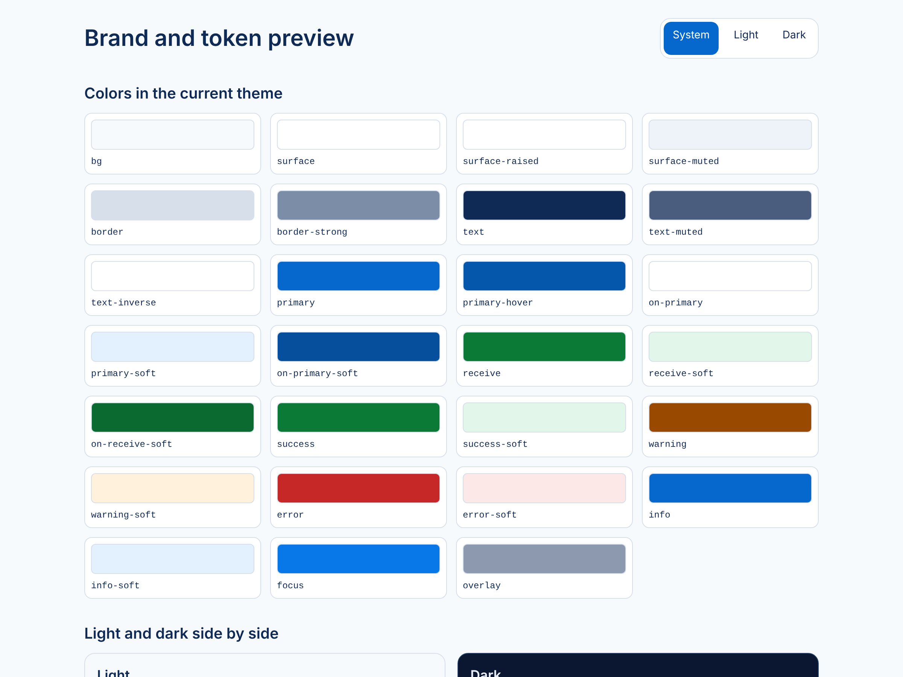
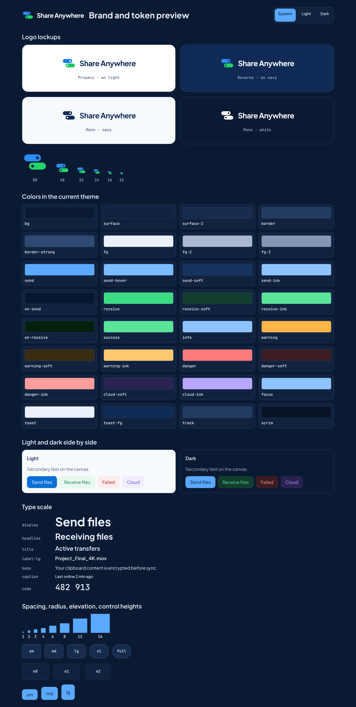

# Phase 0 report — Foundation

Status: **implemented**. The Claude Design handoff was committed by the user in 089e59c (the DesignSync connector could not authorize from this cloud session) and applied in 29a3e09 and 8993201. Device-only behavior (Android launcher masks, iOS asset catalog compilation, Firefox and WebKit rendering) is untested here and is verified by later CI jobs.

Date: 2026-11-10. Branch: `claude/practical-lovelace-avlb5g`.

## Inventory

| Item | Value |
|---|---|
| Repository at start | Documentation only (`CLAUDE.md`, master prompt, `docs/`) |
| Go | go1.24.7 installed; module pins `go 1.27` / `toolchain go1.27.3` (auto-downloaded) |
| Node | v22.23.4 |
| pnpm | 10.28.0 |
| JDK | OpenJDK 21.0.12 (CI will use 17 for Android) |
| Gradle | 8.14.3 |
| Android SDK | not available |
| Xcode / Swift | not available (Linux) |
| Docker | Engine 29.9.2, Compose v5.6.1 (daemon started manually) |
| PostgreSQL | 16.15 (local cluster, stopped by default) |
| Playwright | 1.63.0 with Chromium only (Firefox and WebKit run in CI) |
| golangci-lint | v2.15.0 (installed with Go 1.27.3) |

Exact pins and the reasons for them are in `docs/ADR/0001-monorepo-and-toolchain.md`.

## 1. What was implemented

### Implemented and tested

- **Backend skeleton** (`backend/`): validated configuration, JSON logging with redaction of tokens, secrets, emails, codes, IPs, tickets, JWT-shaped strings (including inside errors and sensitive groups), `/healthz`, `/readyz` with a database check that hides error details, JSON 404/405, security headers, request logging without query strings, panic recovery that respects `http.ErrAbortHandler`, middleware ready for WebSocket hijacking, graceful shutdown, and a `-healthcheck` flag for distroless images.
- **Design token pipeline**: `shared/design/tokens.json` with a JSON Schema, a WCAG contrast check for every declared text pair (4.5:1) and non-text pair (3:1) in both themes, a generator for Web CSS variables and TypeScript, and `--check` mode for CI. Kotlin and Swift targets are documented hooks for Phases 6 and 7.
- **Web scaffold** (`web/`): Vite 6, React 18.3.1, strict TypeScript, Tailwind wired only to token variables, theme preference (system, light, dark), dev-only `/brand` token preview excluded from production builds, hidden source maps, lint guard against Web Storage outside the preference wrapper.
- **Docker Compose**: development stack with HTTPS through Caddy's internal CA on `https://localhost:8443`, and a CI stack on `http://localhost:8080`; coturn with `use-auth-secret`, user quota, and relaying blocked to private and reserved ranges.
- **CI** (`.github/workflows/ci.yml`): path-filtered `docs`, `security` (gitleaks, govulncheck, pnpm audit, dependency review on PRs, Trivy), `backend`, `web`, `protocol`, and a `compose` smoke test using the real Dockerfiles. `nightly.yml` is a documented stub.
- **ADRs 0001 to 0006**, README, `.env.example`, `.nvmrc`, `.editorconfig`, `.gitignore`, `.npmrc`.
- **QA agent** `.claude/agents/qa-reviewer.md` and the first QA round (`docs/qa/PHASE_0_QA.md`).

### Implemented from the design handoff

- **Design import**: `design/claude-design/` with the ten exported files unchanged.
- **Tokens**: `shared/design/tokens.json` carries the Design System values and names (`bg`, `surface`, `surface-2`, `border`, `fg`, `fg-2`, `fg-3`, `send*`, `receive*`, `warning*`, `danger*`, `cloud*`, `focus`, `toast`, `track`, `scrim`), type scale (display to code), spacing, radius, elevation (no shadows in dark), focus ring 2 + 2, control heights 36/44/52, and the `rail`/`sidebar` breakpoints. Every text pair passes WCAG AA in both themes, including the theme-following logo wordmark.
- **Logo and icons**: one logo definition generates 26 files (`pnpm brand`): Web SVG and PNG favicons (16 px dotless), ICO, PWA icons and manifest, Android adaptive icon with a monochrome layer and a Play Store PNG, iOS 1024 px light/dark/tinted icons without an alpha channel. `brand:check` compares vectors byte for byte and rasters pixel for pixel.
- **Strings**: `shared/i18n/en.json` and `vi.json`, 1588 keys each, from `i18n-strings.json`, every `{en, vi}` table and the Vietnamese pattern translations in the three prototypes, the Handoff Checklist microcopy, and `shared/i18n/product.json` for PRD strings the design lacks; EN/VI keys and placeholders are validated.
- **Web**: self-hosted Plus Jakarta Sans and JetBrains Mono, a theme-following `Logo` component, the `/brand` preview with lockups and every token.
- **Docs**: `docs/DESIGN_SYSTEM.md`, `docs/design/DESIGN_DEVIATIONS.md` (PRD-wins items, adopted design decisions, accessibility notes, PRD elements the design lacks, answers to the handoff's open questions), design screen IDs and state models in `docs/UX_SCREEN_MAP.md` §12, one definition of the screen-on pill in `docs/ARCHITECTURE.md` §7.3.

## 2. Screens and routes usable, by platform

| Platform | Usable |
|---|---|
| Web | `/` scaffold page (replaced in Phase 1), `/brand` in development builds only |
| Android | none (Phase 6) |
| iOS | none (Phase 7) |

## 3. End-to-end workflows executed

| Workflow | Where | Result |
|---|---|---|
| Dev Compose stack: postgres, backend, web, coturn, Caddy | Local Docker with host-built images | All services up; `/healthz` 200; `/readyz` database ok; web served over HTTPS |
| CI Compose stack with backend health check | Local Docker with host-built images | All healthy |
| CI Compose stack with the real Dockerfiles | GitHub Actions `compose` job | Green on runs 42779955558 (8ef378e), 42781828564 (259582c) and 42782979011 (d44226e) |
| `/brand` in light and dark | Chromium (Playwright), local dev server | Renders both themes with the design fonts and lockups (screenshots below) |
| Logo wordmark contrast on `/` | Chromium, light and dark | `#102A56` on `#F7FAFD` (light), `#FFFFFF` on `#0B1A33` (dark) |

No product workflow exists yet, so nothing ran as guest or signed in.

## 4. Commands and results

| Command | Result |
|---|---|
| `pnpm tokens:check` | Schema valid, contrast AA (including the logo wordmark), generated files current |
| `pnpm i18n:check` | 1588 keys each in EN and VI, placeholders match |
| `pnpm brand:check` | 26 files current |
| `pnpm test:scripts` | 16 passed |
| `pnpm lint:md` | 0 issues |
| `pnpm audit` | No known vulnerabilities |
| `web`: `format:check`, `lint`, `typecheck`, `test`, `build` | All pass; 14 tests; main bundle under the 120 kB gzip budget |
| `backend`: `gofmt -l`, `go vet`, `golangci-lint run` (v2.15.0) | Clean |
| `backend`: `go test -race ./...` | 5 packages pass, including a real PostgreSQL ping (run by QA) |
| `govulncheck` v1.9.0 on Go 1.27.3 | No vulnerabilities |
| gitleaks v8.24.3 | No leaks (one historical fixture ignored by fingerprint) |

CI runs on this branch: <https://github.com/Juliolayme/share_anywhere/actions?query=branch%3Aclaude%2Fpractical-lovelace-avlb5g>. Exit-gate evidence: run 42779955558 on 8ef378e, all seven jobs green (`security` with gitleaks, govulncheck, pnpm audit, and Trivy; `backend`; `web`; `protocol`; `compose`; `docs`; `changes`). Earlier runs: 42769204329 (1652d6a) failed in `security` on gitleaks; 42771308979 (754b7f4) and 42777834542 (29a3e09) green; the run for 8993201 was cancelled by the next push.

## 5. Environment variables and external services

All variables are listed in `.env.example`: `SA_ENV`, `SA_HTTP_ADDR`, `SA_LOG_LEVEL`, `SA_SHUTDOWN_TIMEOUT`, `SA_ALLOWED_ORIGINS`, `DATABASE_URL`, `POSTGRES_PASSWORD`, `TURN_SHARED_SECRET`, `TEST_DATABASE_URL`. No external service is required yet.

## 6. Known limitations and untested behavior

- Docker builds cannot reach the internet from inside containers in this cloud environment, so local Compose checks use host-built images; the real Dockerfiles are verified only in CI.
- Only Chromium is available locally; Firefox, WebKit, and iPhone-profile checks start in CI with Phase 1.
- coturn's TLS listener is not configured (Phase 8). Its shared secret is passed on the command line in dev and CI; production uses a mounted configuration (Phase 9).
- The web container's CSP still allows inline styles and Caddy runs as root; tightened in Phase 1.

## 7. Backlog

| Priority | Item |
|---|---|
| P1 | Component state colors from the Design System as tokens with dark values, before Button and Input (Phase 1) |
| P1 | Web CSP without inline styles, extra security headers, non-root web container (Phase 1) |
| P2 | Android launcher and iOS asset catalog verification once their CI jobs exist (Phases 6 and 7) |
| P2 | Pin actions by SHA; avoid duplicate push and PR runs (Phase 9) |

## 8. Local run instructions

See the README: `cp .env.example .env`, then `docker compose up --build`, then open <https://localhost:8443>.

## 9. Commits

| Commit | Summary |
|---|---|
| bf9ce04 | Claude Design handoff recorded as the UI source of truth; qa-reviewer agent; markdown lint fixes |
| 303721f | Phase 0 scaffolds, Compose, CI, ADRs |
| 1652d6a | Go 1.25 build image and Trivy invocation (superseded) |
| 754b7f4 | QA round 1 fixes: Go 1.27, audit clean, gitleaks, redaction, middleware, lint guard, CI hygiene |
| b7134b5 | Phase 0 report and QA record (before the design import) |
| 089e59c | Claude Design handoff imported by the user |
| 29a3e09 | Design applied: tokens, logo and icons, i18n catalogs, DESIGN_SYSTEM, deviations, screen IDs |
| 8993201 | QA round 2 fixes: theme-following logo, every design string table plus product overlay, pill unification, deviations section E, brand check, iOS alpha |
| 8ef378e | Report and QA record for the design work |
| 259582c | QA round 3 fixes: pattern translations, product strings for PRD microcopy, PRD §9 key table with test, pill copy unified |
| d44226e | QA round 4 fixes: connection-log strings, remaining PRD strings as keys, iOS notification wording, doc cleanups |
| (this commit) | QA round 5 record and P2 cleanups: badge and Web log keys, inline-pair extractor guard |
