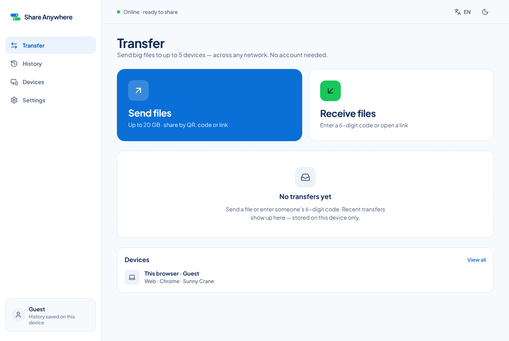
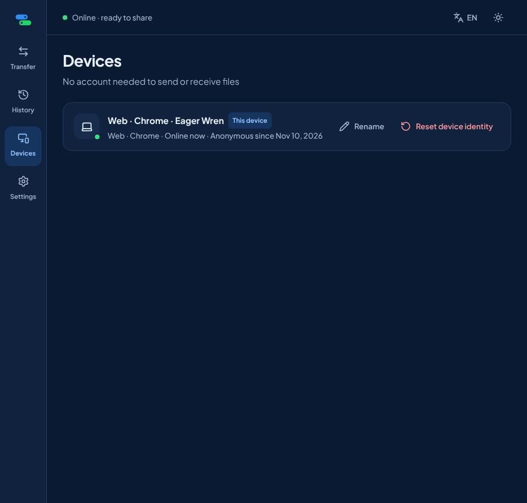
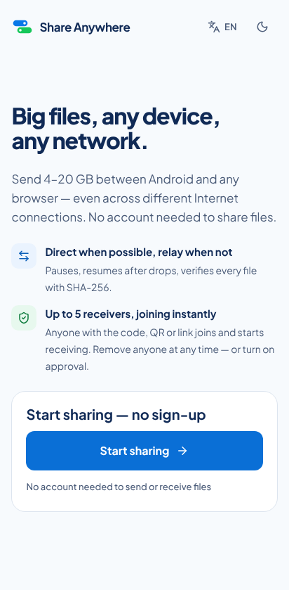
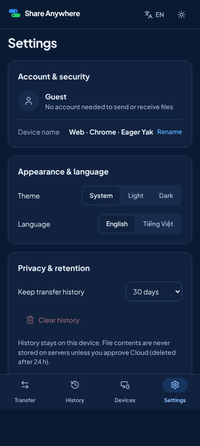

# Phase 1 report: backend core, anonymous device identity, guest-first Web shell

Status: **implemented**. The backend, the Web shell, and the guest Playwright suite run locally on Chromium (desktop and the Pixel 7 profile). Firefox, WebKit, and the iPhone 14 profile run only in the CI `e2e-web` matrix. No accounts and no sign-in UI exist.

Date: 2026-11-10. Branch: `claude/practical-lovelace-avlb5g`.

## 1. What was implemented

### Implemented and tested

**Backend**

- **`internal/devices`**:
  - Anonymous bootstrap (`POST /v1/devices/anonymous`), with a proof-of-work above 3 creations per hour per address and `429` above 10.
  - Ed25519 access tokens with `kid` rotation; 15 minutes.
  - Refresh-secret rotation with reuse detection: reuse revokes the device and deletes its secrets.
  - `GET` and `PATCH /v1/devices/current`, `POST /v1/devices/current/reset`.
  - Hourly purge: unused anonymous devices after 30 days, revoked devices after a day.
  - Format and lifetimes are in ADR 0008.
- **`internal/platform`**:
  - `access`: a router that registers every route with its level and enforces it (`401 device_token_invalid` / `device_token_expired`, `403 account_required` / `device_not_added`).
  - `ratelimit`: token buckets with an injectable clock.
  - `clientip`: `X-Forwarded-For` is believed only from `SA_TRUSTED_PROXIES`; IPv6 is keyed by /64.
  - `ws`: one-time 30-second tickets, an exact `Origin` check before the ticket is consumed, 3 sockets per device and 20 per address, 50 messages per second, a 25-second ping, and a `WELCOME` message with `server_time`.
  - `db.Migrate`: goose with an advisory lock (ADR 0007).
  - `httpx`: the error format and `Retry-After`.
  - `config`: token keys, server secret, trusted proxies, cookie `Secure`, proof-of-work difficulty, migrate on start, and the test-only rate-limit multiplier.
  - Request logs carry `ip_hash` (a keyed hash of the /24 or /48) instead of the address.
- **Migration `0001_devices`**: tables `devices` and `device_refresh_secrets`.
- **Contract**:
  - `shared/protocol/openapi.yaml` declares `x-sa-access` on all 10 operations.
  - Go types are generated with oapi-codegen (`go generate`), TypeScript types with openapi-typescript (`pnpm protocol`).
  - `shared/protocol/websocket-events.json` describes the WebSocket events.
  - `scripts/protocol.mjs --check` validates OpenAPI, checks levels against `docs/API.md` §2.1 in both directions, validates the WebSocket schema against `docs/API.md` §4, and checks that the generated client is current.

**Web** (design screen IDs from `docs/UX_SCREEN_MAP.md` §12)

- `welcome` (ON-1): one primary action, **Start sharing**, shown only on the first visit.
- Shell:
  - Navigation follows the design: a 256 px sidebar from 1100 px, an 80 px rail from 760 px, a bottom bar below 760 px.
  - Header: online and identity status, language and theme toggles, and a skip link.
  - The Clipboard tab and every Sign in entry are hidden by flags (`web/src/config/flags.ts`).
- `home` (TR-1): Send and Receive cards, offline banner, inline identity notice (offline, rate limited with a countdown and a disabled retry, failed with retry), recent local history or the empty state, and a This device card.
- `send` / `send-review` (TR-2/3): real file input with drag and drop, file list with remove, total, and the 20 GB limit error. **Create** sits behind the `sharing` flag, and an info banner says sharing is not in this version.
- `receive` (RX-1): six digit cells with paste, arrow and backspace navigation, validation (`product.code_incomplete`), and same-origin `/j/<token>` link validation. **Join** sits behind the `sharing` flag.
- `history` (HI-1): IndexedDB store with tabs, search, status, date and device filters, retention sweep, clear with confirmation, loading, empty, no-match, and storage-blocked states.
- `devices` (DV-1): This device with rename (validated, toast) and Reset device identity (confirmation; the old token stops working at once).
- `settings` (ST-1, guest): Guest header without Sign in, device name, theme System/Light/Dark, language English/Tiếng Việt, history retention 30 / 90 days / Don't keep, Clear history, privacy text, version.
- `DeviceClient`:
  - The access token lives in memory only.
  - Refresh uses the `sa_device` cookie with `X-SA-Refresh: 1`, 60 s before expiry, single-flight inside a tab and across tabs (Web Locks).
  - A request that gets `401` refreshes and retries once.
  - The client solves the proof-of-work with Web Crypto.
  - A `429` wait time comes from `retry_after_s` or `Retry-After`.
- i18n runtime over `shared/i18n` (named and positional placeholders, English fallback). Vietnamese is lazy-loaded at 13 kB gzip. The Android and iOS namespaces are tree-shaken out of the bundle.
- Web container:
  - CSP without `'unsafe-inline'`.
  - `Permissions-Policy` and `Cross-Origin-Opener-Policy`.
  - Caddy listens on 8080 as a non-root user.

### Implemented but untested

- Firefox, WebKit, and `ios-safari` runs of the guest suite. They are configured in the CI matrix; results are in §4.
- Cross-tab refresh serialization with Web Locks. The code path is covered by unit tests with an injected lock; two real tabs refreshing at the same moment were not exercised.
- Production configuration (`SA_ENV=production` with real keys behind Caddy TLS). Validation is unit-tested; a production deployment is Phase 9.

### Partially implemented

- **Feature-flagged actions:** Send review has no Create button and Receive has no Join until Phase 2 turns on `sharing`.
- **Optional CAPTCHA adapter** (`docs/SECURITY_MODEL.md` §4): not built (backlog P2).
- **Licenses page:** not built (deviation F7).

### Planned (later phases)

Share sessions, joining, signaling, and keep-screen-on (Phase 2); transfers (Phase 3); accounts (5A); clipboard (5B); Android (6); iOS (7).

## 2. Usable screens and routes

| Platform | Screens / routes |
|---|---|
| Web (all browsers) | `/welcome`, `/` Transfer home, `/send`, `/receive`, `/history`, `/devices`, `/settings`; unknown paths render a not-found page inside the shell |
| Backend | `/healthz`, `/readyz`, `/v1/devices/anonymous/challenge`, `/v1/devices/anonymous`, `/v1/devices/token`, `/v1/devices/current` (GET, PATCH), `/v1/devices/current/reset`, `/v1/ws/ticket`, `/v1/ws` |
| Android, iOS | None in this phase |

Screenshots (Chromium, local Compose stack):






## 3. End-to-end workflows executed (all as guest)

Local runs used the Compose CI stack (`docker-compose.ci.yml` with host-built binaries, because container builds here have no internet) and Playwright 1.63.0.

| Workflow (`web/e2e/`) | chromium-desktop | android-chrome | firefox-desktop | webkit-desktop | ios-safari |
|---|---|---|---|---|---|
| Welcome → Start sharing → Transfer home, no sign-in anywhere, Welcome only once | Passed locally | Passed locally | CI | CI | CI |
| Reload keeps the same device ID | Passed locally | Passed locally | CI | CI | CI |
| Rename in Devices, name shown in Settings and kept after reload; Settings says Guest | Passed locally | Passed locally | CI | CI | CI |
| Theme and language persist across reloads | Passed locally | Passed locally | CI | CI | CI |
| Reset identity gives a new device ID that survives reload | Passed locally | Passed locally | CI | CI | CI |
| Simulated `429` shows the wait time and a disabled retry; navigation still works | Passed locally | Passed locally | CI | CI | CI |
| Code entry validation | Passed locally | Passed locally | CI | CI | CI |
| History empty state and local-only label | Passed locally | Passed locally | CI | CI | CI |
| Mobile: bottom navigation, touch targets ≥ 44 px, no horizontal scroll, code cells | skipped (desktop) | Passed locally | skipped | skipped | CI |

Server-side flows were also checked by hand against the binary with a real PostgreSQL 16: create with cookie, refresh with `X-SA-Refresh`, migrations applied, `/readyz` database ok.

## 4. Commands and results

| Command | Result |
|---|---|
| `go vet ./...`, `golangci-lint run` (v2.15.0) | Clean, 0 issues |
| `TEST_DATABASE_URL=… go test -race -count=1 ./...` (PostgreSQL 16 container) | 12 packages pass |
| Coverage | `devices` 89.2 % with PostgreSQL (76.9 % without), `access` 97.8 %, `ratelimit` 100 %, `clientip` 91.4 %, `httpserver` 97.1 %, `ws` 85.4 %. CI gate is ≥ 70 % for each |
| `govulncheck ./...` (v1.9.0) | No vulnerabilities |
| `pnpm protocol:check` | 10 operations valid and in agreement with `docs/API.md`; generated client current |
| `pnpm tokens:check`, `i18n:check` (1625 keys each), `brand:check`, `test:scripts` (20/20), `lint:md`, `pnpm audit` | All pass, no known vulnerabilities |
| `pnpm --filter web format:check`, `lint`, `typecheck`, `test` | Pass; 42 unit tests in 8 files |
| `pnpm --filter web build` | Main JS 90.5 kB gzip (budget 120 kB); Vietnamese catalog chunk 13 kB gzip |
| `playwright test --project=chromium-desktop --project=android-chrome` | 18 passed, 2 skipped (mobile-only specs on desktop) |
| `docker compose -f docker-compose.ci.yml up --wait` (host-built images) | All services healthy; `/readyz` database ok; web CSP header present |
| CI run 42784930757 (backend commit 38580ab) | success |
| CI run 42787423644 (Web commit 0a37732) | failure: the Web image build lacked `shared/i18n` (compose and e2e-web). Fixed in f6f559c; later runs are recorded in `docs/qa/PHASE_1_QA.md` |

## 5. Environment variables and external services

New in this phase (all in `.env.example`): `SA_MIGRATE_ON_START`, `SA_TRUSTED_PROXIES`, `SA_COOKIE_SECURE`, `SA_POW_DIFFICULTY`, `SA_TOKEN_KEYS`, `SA_TOKEN_ACTIVE_KID`, `SA_SERVER_SECRET`, `SA_RATE_LIMIT_MULTIPLIER` (test only).

- Production refuses to start without token keys, a server secret, and a database.
- Development and test generate ephemeral keys, so tokens stop working after a restart.
- Web build flags: `VITE_FLAG_SHARING`, `VITE_FLAG_ACCOUNTS`, `VITE_FLAG_CLIPBOARD` (all off).

External services: PostgreSQL 16 only. No third-party service is used.

## 6. Known limitations and untested behavior

- **In-memory state is per instance.** Rate-limit buckets, WebSocket tickets, and proof-of-work nonces live in process memory, which is correct for the single-instance MVP. Running several instances needs a shared store and an ADR (`docs/SECURITY_MODEL.md` §5).
- **Revocation delay across instances.** The active-device cache means another instance sees a revocation up to 30 seconds later.
- **Test stack settings.** The CI stack turns off the cookie `Secure` attribute (plain HTTP on localhost, where WebKit would drop it) and multiplies rate limits by 100, because all browsers share one address. Both settings are refused outside `SA_ENV=test`. The dev stack keeps `Secure` behind Caddy TLS.
- **iOS projects are emulation only.** Results from `ios-safari` mean "verified on WebKit emulation, not on a real iOS device".
- **No WebSocket client yet.** The Web app opens no WebSocket in this phase; the endpoint is covered by backend tests only.

## 7. Backlog

| Priority | Item |
|---|---|
| P0 | Phase 2: sessions, joining, signaling, keep-screen-on; turn on `sharing` |
| P1 | Two-tab refresh e2e (Web Locks) once Phase 2 adds multi-context specs |
| P1 | Shared rate-limit and ticket store before running more than one backend instance |
| P2 | Optional CAPTCHA adapter; licenses page; Home connection card once a route probe exists (deviation F3) |

## 8. Local run

```bash
cp .env.example .env
```

```bash
docker compose up --build
```

Open `https://localhost:8443` and accept Caddy's local certificate. For the automated test stack:

```bash
docker compose -f docker-compose.ci.yml up -d --build --wait
```

```bash
pnpm --filter @share-anywhere/web exec playwright test --project=chromium-desktop
```

## 9. Commits

| Commit | Summary |
|---|---|
| fad43f9 | Phase 0 QA round 5 record and P2 cleanups (closes Phase 0) |
| 38580ab | Backend: anonymous device identity, access levels, WebSocket tickets, migrations, protocol tooling, ADR 0007/0008 |
| 0a37732 | Web: guest-first shell, identity client, IndexedDB history, Playwright suite, e2e-web CI job, CSP, IP hashing in logs |
| f6f559c | Web image build copies `shared/i18n` (CI compose and e2e-web fix) |
| (this commit) | Phase 1 report |
