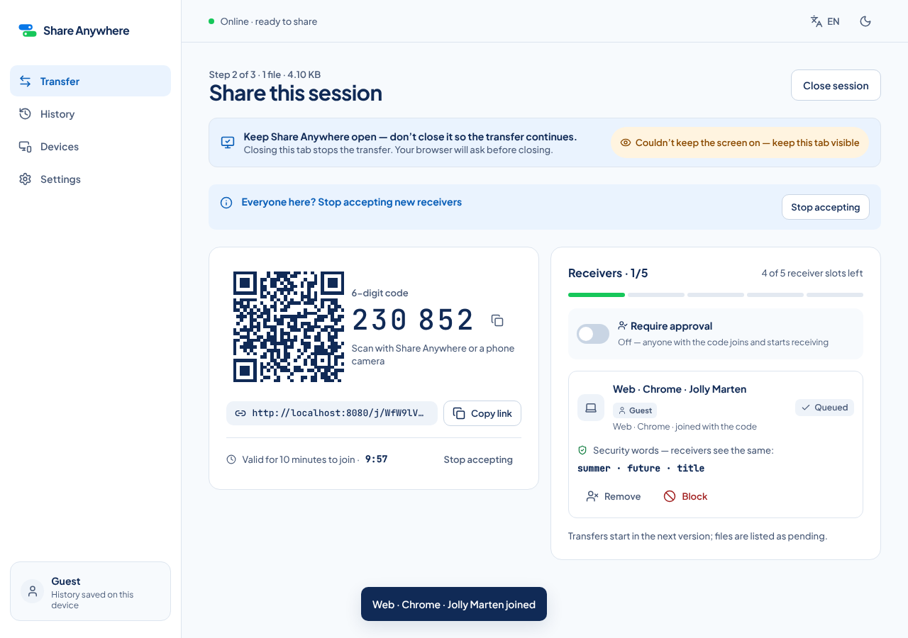
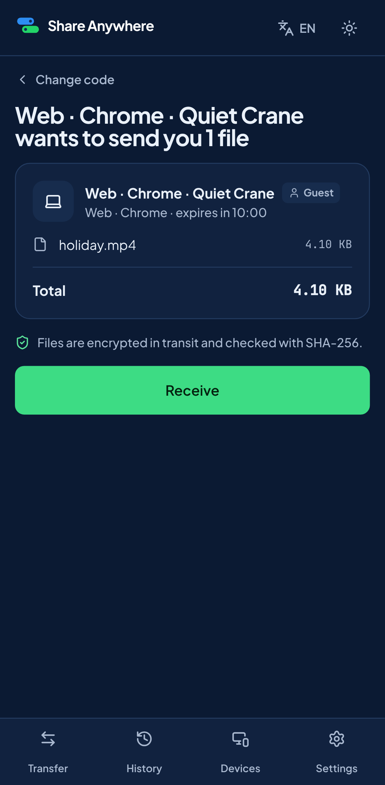

# Phase 2 report: share sessions, joining, signaling (first vertical slice, no account)

Status: **implemented**. The guest-only vertical slice works locally in Chromium (desktop and the Pixel 7 profile): a guest creates a session, a guest receiver joins by link or code with no sender action, and both see the same security words. Firefox, WebKit, and iPhone 14 receivers run only in the CI `e2e-web` matrix. File bytes arrive in Phase 3.

Date: 2026-11-10. Branch: `claude/practical-lovelace-avlb5g`.

## 1. What was implemented

### Implemented and tested

**Backend**

- **Migration `0003_sharing`.** Sessions, participants, blocks, shared files, capability tokens, transfers (created `PENDING` when a receiver is admitted), and session events.
- **`internal/sharing`:**
  - Session creation with file metadata and Require approval.
  - Six-digit code: stored as an HMAC that is unique among open windows, plus an AES-GCM copy only the sender can read back.
  - Link/QR token of 192 bits, hashed at rest.
  - One 10-minute join window. It ends on timeout, when the fifth receiver joins, or on Stop accepting. Create new code issues a new code and link and invalidates the previous ones.
  - Single-use join tickets of at most 5 minutes, never past the window end, bound to the device and the window.
  - Open join by default. Joins are `REQUESTED` when approval is on, or when protected mode applies to a code join.
  - Atomic five-receiver cap under a row lock; pending requests count toward the five slots.
  - Sender controls: Approve, Reject, Remove, Block (device ID and IP /64), Stop accepting, Require approval (future joins only), Close.
  - Receivers can leave.
  - Three security words from the session and device, using the 2048-word BIP-0039 English list.
  - Lockouts: failed lookups per address (10/hour) and per device (5 per 10 minutes) lock out for 30 minutes.
  - Global protected mode for 30 minutes.
  - Limits on creation, open sessions, lookups, joins, renewals, and TURN.
  - Lifetimes: idle 30 minutes, maximum 24 hours for guests (72 hours for signed-in senders, tested by injecting a signed-in caller), purge after 7 days.
- **`internal/signaling`.** Relays `OFFER`/`ANSWER`/`ICE_CANDIDATE` over the WebSocket only between the sender and a `JOINED` receiver of a live session. Payloads are capped at 32 KiB. Errors return as `ERROR` events.
- **`internal/turncreds`.** coturn `use-auth-secret` credentials (an automated test allocates a relay on the stack's coturn with an issued credential and checks that wrong-secret and expired credentials are refused) for the sender or a `JOINED` receiver of an `ACTIVE` session: guest TTL 30 minutes, account 60 minutes, 20 or 60 credentials per hour.
- **Privacy and metrics.** Participants and blocks store only a keyed hash of the address (migration 0004). Aggregate counters (sessions, joins, requests, blocks, failed lookups, lockouts, protected-mode activations and seconds) are served on an internal `/metrics` listener (`SA_METRICS_ADDR`).
- **WebSocket hub.** Connection registry, a writer goroutine per socket, message dispatch, and sockets closed when a device is revoked (resolves the Phase 1 backlog item P2-7).
- **Access router.** 405 fallbacks are registered per method after all routes, so literal and wildcard paths coexist.
- **Test builds** (`-tags testhooks`, used only by the CI Compose stack) add an adjustable clock, a protected-mode switch, and a device-lockout hook.
- **Contract.** `openapi.yaml` covers §2.1 and §2.2: 24 operations, each with `x-sa-access`, checked against `docs/API.md` in both directions. `websocket-events.json` defines every Phase 2 event. New error codes are in `docs/API.md` §3.

**Web** (sharing flag on)

- **`send-review`.** Create share session with the Require approval switch.
- **`session`, `session-full`, `session-expired`, `session-approved` (TR-4, TR-5):**
  - QR code, six-digit code, link with copy and share.
  - Countdown from 10:00 using the server-time offset.
  - Expired state (`common.cx_h`) with Create new code. Full state with Create new code disabled.
  - Stop accepting and the nudge after the first join (`product.stop_nudge`).
  - Protected-mode notice.
  - Receiver slots and capacity bar. Require approval toggle.
  - Participant cards with the Guest or Signed in badge and security words. Request cards with Approve and Reject. Remove, and Block with confirmation.
  - Join toasts. Close dialog (TR-8). Ended state.
- **`receive` / `receive-preview` (RX-2 to RX-4; `/j/<token>` resolves on `receive-preview`):**
  - The code goes to the preview; `/j/<token>` opens the preview without the Welcome screen.
  - Preview shows the sender with badge, files, total, "Join within m:ss" in the last minute, and the expired message if the window ends first.
  - Lookup and join errors map to the catalog messages: not found, code expired, full, not accepting, blocked, session ended, locked out with the wait time.
- **`receive-wait` (RX-5).** Waiting for approval with the security words, the protected-mode explanation, and Cancel.
- **Receiver outcomes.** A joined state (transfers pending) and outcomes (RX-7): removed, blocked, declined, closed, expired.
- **Keep-awake controller (ARCHITECTURE §7):**
  - Uses the Screen Wake Lock API. Holds while the sender's join window is open and while a receiver waits for approval.
  - Releases when the window ends, on close, on leave, and when the setting is off.
  - Asks for the lock again on `visibilitychange`.
  - Unsupported and Refused states. `beforeunload` while active.
  - Keep-open banner with the screen-on pill on TR-4, TR-5, and RX-5.
  - Settings switch "Keep screen on during transfers" (default on).
- **WebSocket client.** One-time tickets, reconnect with backoff, and session events refresh the views.

### Implemented but untested

- **WebSocket signaling between two browsers.** The relay is unit-tested and the server routes are covered by integration tests. Clients start sending SDP in Phase 3.
- **Real Screen Wake Lock.** Headless Chromium refuses it, so the UI shows the Refused state. That is the expected behavior and is asserted with the stub; the granted path is asserted with the stub only.
- **Mobile QR legibility.** Asserted by size (QR ≥ 160 px, code ≥ 28 px) rather than by a visual snapshot (see §6).

### Partially implemented

- **Sixth-receiver notice to the sender.** The join is refused and the sender sees "5/5 · Session full", but there is no per-attempt notice (deviation F13).
- **Transfer records.** Created as `PENDING` with no state changes yet (Phase 3).

### Planned (later phases)

Transfers, the save location, and the dashboard (Phase 3); resilience (Phase 4); accounts (5A).

## 2. Usable screens and routes

| Platform | Screens / routes |
|---|---|
| Web | `/send` (with Create), `/send/session/:id`, `/receive` (Continue, Open link), `/j/:token`, `/join/preview`, `/receive/:sessionId`, Settings › Data › Keep screen on |
| Backend | §2.1 plus `POST /v1/sessions`, `GET`/`PATCH /v1/sessions/{id}`, `/close`, `/renew`, `/resolve-code`, `/resolve-link`, `/{id}/join`, `/v1/participants/{id}` (approve, reject, DELETE, block, leave), `POST /v1/turn/credentials`, WebSocket `OFFER`/`ANSWER`/`ICE_CANDIDATE` |
| Android, iOS | None in this phase |

## 3. End-to-end workflows executed (all guests)

Local runs used the CI Compose stack, with a backend built with `-tags testhooks` and the Web built with sharing on. The sender is always in Chromium.

| Workflow (`web/e2e/`) | chromium-desktop | android-chrome | firefox / webkit / ios-safari |
|---|---|---|---|
| Link in a fresh context → preview → Receive → joined immediately; sender toast, Guest badge, same words | Passed locally | Passed locally | CI |
| Code join, open session | Passed locally | Passed locally | CI |
| Approval on → wait → approve; reject path | Passed locally | Passed locally | CI |
| Remove, rejoin, Block; blocked device refused | Passed locally | Passed locally | CI |
| Stop accepting → code and link refused with the right message | Passed locally | Passed locally | CI |
| Sixth receiver sees "session full"; sender sees 5/5 | Passed locally | Passed locally | CI |
| Unknown code, expired link page | Passed locally | Passed locally | CI |
| Locked-out device sees the wait time (test hook) | Passed locally | Passed locally | CI |
| Mobile waiting screen with Refused pill fits 390 px | skipped (desktop) | Passed locally | ios-safari in CI |
| Clock +10 min: expired state, old code and link refused, early receiver still in, Create new code at 10:00, new code joins | Passed locally | Passed locally | CI |
| Protected mode (hook) → code join waits with the explanation → approve | Passed locally | Passed locally | CI |
| Keep-awake stub: granted (On, release after Close), refused, unsupported, hidden→visible re-request, pill off, setting off → no request | Passed locally | Passed locally | CI |
| Mobile: QR and code size, no horizontal scroll | skipped (desktop) | Passed locally | ios-safari in CI |

After the QA fixes the full suite passes locally on chromium-desktop and android-chrome: 54 passed and 4 skipped (mobile-only specs on desktop).

## 4. Commands and results

| Command | Result |
|---|---|
| `go vet ./...`, `golangci-lint run` (also with `--build-tags testhooks`) | Clean |
| `TEST_DATABASE_URL=… go test -race -count=1 -cover ./...` | All packages pass. Coverage: `sharing` 79.0 %, `signaling` 83.3 %, `turncreds` 83.3 %, `ws` 89.0 %, `devices` 88.9 %, `access` 98.1 % |
| Sharing integration tests | Open join by code and link with signaling scope; approval and toggle; protected mode with an injected clock; 20 concurrent joins with exactly 5 successes under `-race`; Remove and Block (device and /64); join window at 9:59, 10:00, the 9:58 ticket, full, Stop accepting, renew; renew while full; approval after expiry; lockouts; creation and open-session limits; TURN authorization; idle, 24 h, purge |
| `govulncheck ./...` | No vulnerabilities |
| `pnpm protocol:check` | 24 operations agree with `docs/API.md`; WebSocket schema valid |
| `pnpm --filter web format:check`, `lint`, `typecheck`, `test` | Pass; 55 unit tests (keep-awake controller, countdown with server offset, expired, full and renew states, words and badges) |
| `pnpm --filter web build` | Main JS 104.6 kB gzip (budget 120 kB) |
| `playwright test --project=chromium-desktop --project=android-chrome` | 54 passed, 4 skipped (mobile-only specs on desktop) |
| CI | Run 42797239669 (49efca8) and run 42800623094 (8356a0a): all 12 jobs green, including `e2e-web` on all five projects and the coturn allocation test in `compose` (Firefox needed retries on 8356a0a). Later runs in `docs/qa/PHASE_2_QA.md` |

## 5. Environment variables and external services

New: `SA_PUBLIC_URL`, `SA_METRICS_ADDR` (internal metrics listener), `SA_TURN_SECRET` (required in production, shared with coturn), `SA_TURN_URIS`, `SA_CODE_GUESS_ALARM_PER_MIN`. The backend now always requires `DATABASE_URL`. The CI image is built with `GO_TAGS=testhooks`. coturn is in both Compose stacks.

## 6. Known limitations

- **In-memory state.** Protected mode, lockouts, and rate-limit buckets live in process memory (single-instance MVP).
- **No visual snapshots for mobile yet.** Size and overflow assertions are used; baselines generated on the CI runner follow in Phase 3 (`docs/TESTING_AND_CI.md` §3).
- **Bundle size.** The main bundle grew to 104.6 kB gzip. Lazy-loading the session screens is backlog if Phase 3 approaches the 120 kB budget.
- **Copy buttons use the clipboard.** Copy code and Copy link call `navigator.clipboard.writeText` on a user click. This is ordinary copying, not Clipboard Sync. The Phase 5B guest-clipboard spec must scope its "zero clipboard calls" assertion to the Clipboard feature.

## 7. Backlog

| Priority | Item |
|---|---|
| P0 | Phase 3: DataChannel transfers, save location, dashboard, history entries |
| P1 | Access matrix generated per level including expired and revoked tokens (Phase 1 backlog P2-5); diagnose Firefox page-load retries in CI (traces are now uploaded on every run) |
| P2 | Sender notice for auto-declined receivers (F13); mobile visual snapshot baselines (Phase 3); lazy-load the session screens |

## 8. Local run

Same as Phase 1: `docker compose up --build`, then open `https://localhost:8443`. To try the slice, open the app in two browser profiles: one sends, and the other enters the code or opens the link.

## 9. Commits

| Commit | Summary |
|---|---|
| b99fd76 | Phase 1 closed (QA PASS) |
| bd34779 | Backend: sessions, open join, signaling relay, TURN credentials, test hooks, migration 0003 |
| 6a4af87 | Web: session, receive, approval, keep screen on, Playwright pairing and keep-awake specs |
| e9b1195 | Docs and report |
| 49efca8 | Deterministic participant order; regenerated Go types |
| 8356a0a | QA round 1 fixes |
| (this commit) | QA round 2 fixes and QA record |
