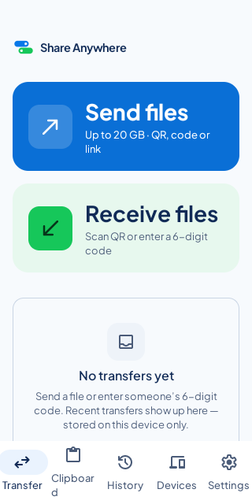
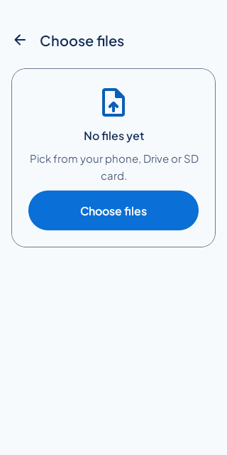
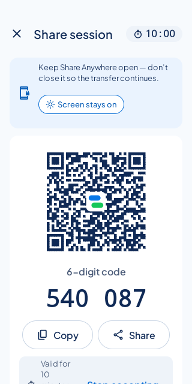
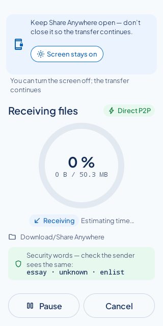
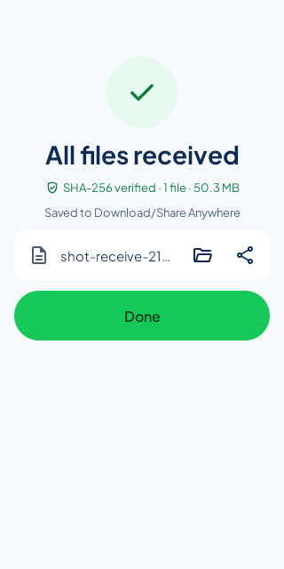
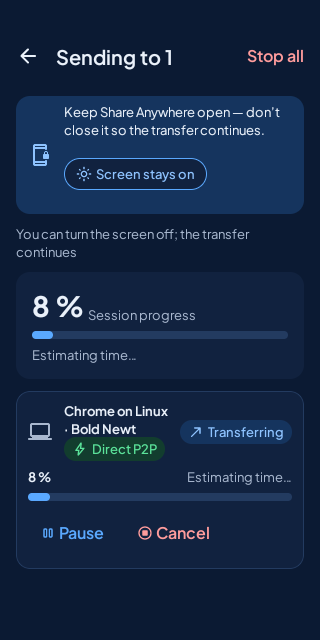
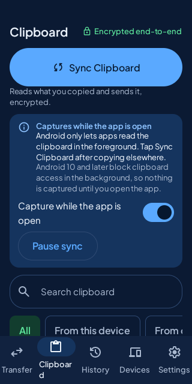
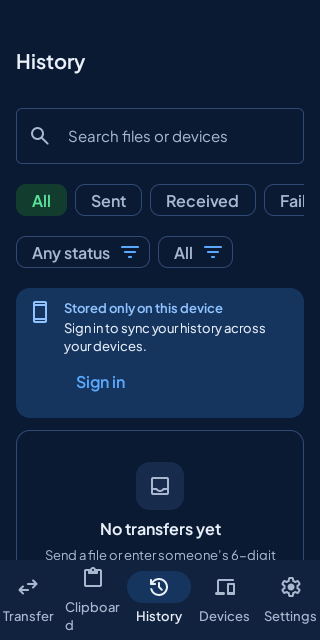
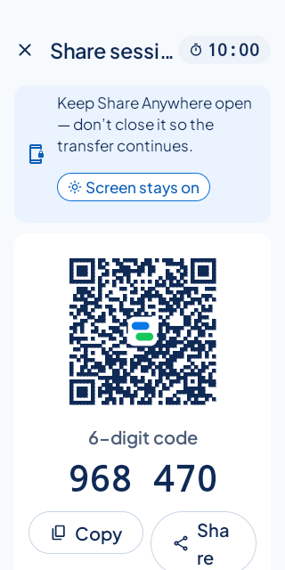
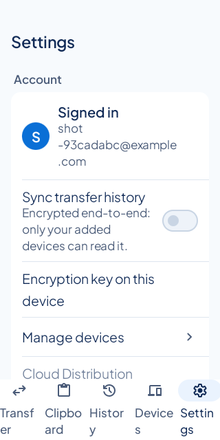

# Phase 6 report: Android app

Status: exit gate met. QA round 4 PASS on 57a0e1e (`docs/qa/PHASE_6_QA.md`); CI [43133792368](https://github.com/Juliolayme/share_anywhere/actions/runs/43133792368) green including the API 34 emulator, nightly [43133792458](https://github.com/Juliolayme/share_anywhere/actions/runs/43133792458) green including API 29 and 35, Android ↔ Web interop and clipboard-cross-client. File sharing stays guest-first on Android: Welcome leads to Transfer home, send and receive never ask for an account, and the account screens are reached only from account entry points (Settings, Devices, History banner, Clipboard intro).

## 1. What was implemented

**Implemented and tested** (JVM tests locally and in CI; instrumentation tests on the Android emulator in CI, API 34 required, API 29 and 35 nightly):

- **Project and shell (6.1).** Gradle project with Kotlin 2.2, Compose BOM, Hilt, Room, OkHttp and kotlinx.serialization, version catalog and lockfiles, minSdk 26 and targetSdk 35 (ADR 0016, 0018). Generated API client and string catalogs from `shared/`. Guest-first start: Welcome once, then Transfer home. Anonymous device identity in the background with the refresh secret in Keystore-backed storage and the access token in memory (`identity/`). Local History in Room with retention, search, filters and detail. Devices "This device" card, Settings.
- **Send and receive (6.2).** SAF multi-select, session creation with Require approval (default off), QR (ZXing, ADR 0019), code and link with the 10:00 countdown on the server clock, Code expired with Create new code, Session full, participants with badges and security words, Remove and Block, request cards, Stop accepting, join snackbar and background notification. Receive by QR (CameraX), code entry, App Links (`assetlinks.json` from Caddy), preview, waiting room, outcomes.
- **Transfers (6.3).** Kotlin transfer engine byte for byte with the Web (`transfer/engine`, `shared/protocol/schemas/transfer-vectors.json`), WebRTC DataChannel through `stream-webrtc-android` (ADR 0017), streaming I/O through `ContentResolver`, bitmap persistence in Room and resume, backpressure, receive into Download/Share Anywhere (MediaStore) or a chosen folder (SAF tree), progress, dashboard, SHA-256 verification. A `dataSync` foreground service with a partial wake lock and Wi-Fi lock only while bytes move, and the Android 15 time budget handled through `onTimeout` (ADR 0020). Keep screen on with the keep-open banner and screen-on pill.
- **Accounts and Clipboard (6.4).** Account key library on BouncyCastle with the Web's vectors and a Keystore-sealed key store (ADR 0021). Account screens as a nested graph: sign in, create account, reset request, add this device, key setup with the 12 words shown once, pairing by QR and `sa1.…` code or by recovery phrase, checklist, sign-out with a new anonymous identity. Settings account section with change password, account device list with rename, revoke (key rotation) and pairing a new device by scanning its QR, History sync banner and encrypted history sync (same entry ids and payload as the Web). Clipboard tab: guest intro with no clipboard access, add device and key steps, Sync Clipboard, foreground-only capture with a lifecycle-aware listener, `EXTRA_IS_SENSITIVE` and heuristic skips, timeline, item sheet, Clipboard settings, a notification for items from other devices whose action opens the app to sync. The Kotlin clipboard engine follows `docs/CLIPBOARD_PROTOCOL.md` §2 like the Web engine (offline queue, cursor, pending deletes, key-version conflict retry).
- **Tests and CI (6.5).** 143 JVM tests (engine vectors, frames, scheduler, crypto vectors, key flows, clipboard engine, sensitive heuristics, history sync, reporter, generated sources). Instrumentation: guest launch, history persistence, identity, sender session, receiver join, transfers both ways, keep screen on (pause, resume, cancel, screen off, no wake lock after, setting off), SAF folder picker, accounts and Clipboard (guest intro without listener, sign-up, add device, key setup, foreground capture, background non-capture, notification action, sign-out with a new device ID), FGS budget (API 35, first green in nightly [43131693430](https://github.com/Juliolayme/share_anywhere/actions/runs/43131693430) on 1f665e7), screenshots. Nightly: `android-web-interop` (64 MB both ways with SHA-256 checks), `android-matrix` (API 29 and 35), `clipboard-cross-client` (Web ↔ Android encrypted clipboard).

**Implemented but untested on a real device**

- App Links verification (needs a public HTTPS origin and a signed release build; `docs/runbooks/android-app-links.md`).
- Clipboard behaviour on real devices (OEM clipboard overlays, timing when the Activity is opened from the notification), battery and thermal behaviour, Play policy review.
- QR scanning with a real camera (the emulator has no back camera in CI).

**Partially implemented / planned**

- Route strategy beyond direct P2P (TURN fallback logic) and Cloud Distribution: Phase 8.
- WorkManager: not used; deferrable network sync is not needed yet (ADR 0018).
- Screenshot of `key-pair` is not captured (QR mode needs a second device; phrase mode is blanked by `FLAG_SECURE`); the screen is covered by the account tests and the nightly `clipboard-cross-client` pairing.

## 2. Usable screens and routes (Android)

Welcome, Transfer home, Send, Session (and expired), Dashboard (and done or partial), Receive (scan, code), Join preview, Waiting room, Save, Receiving, Done, History and detail, Devices (guest card; account list), Settings (guest header; account section), Sign in, Create account, Reset request, Add this device, Key setup, Pair this device (QR or phrase), Checklist, Clipboard (intro, add device, key steps, home, item sheet), Clipboard settings. Screen IDs follow `docs/UX_SCREEN_MAP.md` §12; differences from the design are in `docs/design/DESIGN_DEVIATIONS.md` sections I, J and K.

## 3. End-to-end workflows executed

On the Android emulator in GitHub Actions (API 34 in `ci.yml`, API 29 and 35 in the nightly), against the CI backend stack at `10.0.2.2`:

- As a guest: fresh install to Transfer home without sign-in; create a session and read the code; a second device joins by code under open join; the join window expires (test clock) into Code expired; Create new code; Remove; Require approval and Approve; Block; Close.
- As a guest: send a file to another device and receive a file into Download/Share Anywhere, both verified by SHA-256; keep screen on set while bytes move and cleared on pause, cancel and completion; the foreground service runs while receiving; the transfer completes with the screen off; no wake lock is held afterwards.

- Signed in: create an account, add the device, set up the key, reach the Clipboard history, capture a copy made in front, capture nothing in the background, open the app from the notification, sign out to a new device ID.
- Android ↔ Web (Playwright Chromium on the same runner): 64 MB each way with SHA-256 checks (nightly `android-web-interop`); encrypted clipboard both ways after pairing (nightly `clipboard-cross-client`).

The foreground-service evidence counts only from 32ce925: before it, `TransferRuntime` registered a new controller after watching the controllers, so the first transfer of a process never started the service, and the earlier screen-off and no-wake-lock passes did not exercise it (QA round 3).

Run links are listed in `docs/qa/PHASE_6_QA.md`.

### Screenshots (Android emulator API 34, CI [43131693432](https://github.com/Juliolayme/share_anywhere/actions/runs/43131693432) on 1f665e7)

`ScreenshotTest` captures 27 screens in light, dark and 130 % font (81 PNGs in the `android-emulator-api34` artifact, kept 14 days). A representative set is committed:

| | | |
|---|---|---|
|  |  |  |
|  |  |  |
|  |  |  |
|  | | |

## 4. Commands and results

- `cd android && ./gradlew --no-daemon assembleDebug testDebugUnitTest lintDebug ktlintCheck assembleDebugAndroidTest`: pass (143 JVM tests; lint 0 errors).
- `pnpm -C web exec eslint e2e/nightly`, `prettier --check`, `pnpm -C web run typecheck`: clean.
- `node scripts/gen-i18n.mjs --check`: catalogs current.
- Instrumentation tests do not run in this session (no KVM); CI runs them.

## 5. Environment variables and external services

- Build: `-Pbackend=<url>` sets the debug backend (CI uses `http://10.0.2.2:8080`); `SA_PUBLIC_URL` sets the App Link host; `SA_ANDROID_CERT_SHA256` lets Caddy serve `assetlinks.json`.
- Flags (`android/app/build.gradle.kts`): `FLAG_SHARING`, `FLAG_ACCOUNTS`, `FLAG_CLIPBOARD`, all on.
- No external services beyond the backend stack (`docker-compose.yml`).

## 6. Known limitations and untested behaviours

- Everything under "Implemented but untested on a real device".
- Android 10 and later block clipboard reads in the background; the UI states it, and nothing is captured until the app is in front.
- Direct P2P only: networks that block it fail until TURN fallback arrives (Phase 8).
- The interop job needed test changes to pass (the Web sender page must not reload, and long transfers are watched through state instead of polling the UI); see the QA log.

## 7. Backlog

- P0: none (QA round 4).
- P1: TURN fallback and route strategy (Phase 8); real-device verification of App Links, QR scanning and clipboard behaviour.
- P2: screenshots of the live-transfer screens; WorkManager-based deferred sync if it becomes needed; the QA P2 items listed in `docs/qa/PHASE_6_QA.md`.

## 8. Local run

```bash
cp .env.example .env
docker compose up -d --build
cd android && ./gradlew assembleDebug -Pbackend=http://10.0.2.2:8080
adb install -r app/build/outputs/apk/debug/app-debug.apk
```

The emulator reaches the local backend at `10.0.2.2:8080`.

## 9. Commits

On `claude/practical-lovelace-avlb5g`: 0d264d9, e0ce23f (6.1); 45ae141, 0f4e481, 7f44559, d53afa5, 5c762e6 (6.2); 2649c1d, 8a2ab0c, 9f7a7c4 (6.3); 12bbc4d, 0eb9831, 0268055, c194412 (6.4); 646fe39, 414e89a, 50cdd00, e7e8a50, 82d0f25, 9cc5d4f, 932e14e, 0d2625c, 437f742, bce6c05, 3d536d3, 00ea75d, 6119074, 32ce925, 1f665e7, af64434, 57a0e1e (6.5, tests, CI, QA fixes, screenshots and this report), and the commit recording QA round 4.
