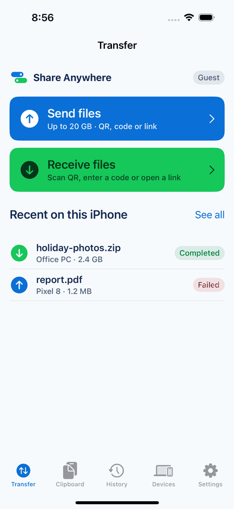
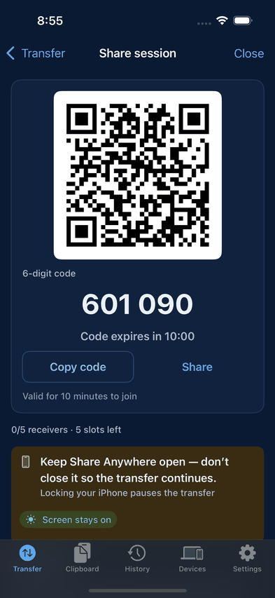
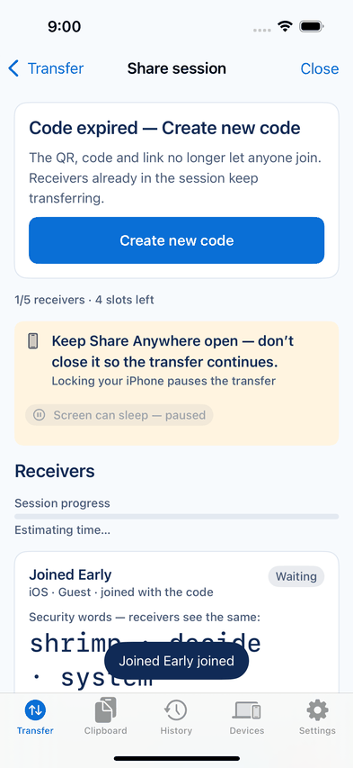
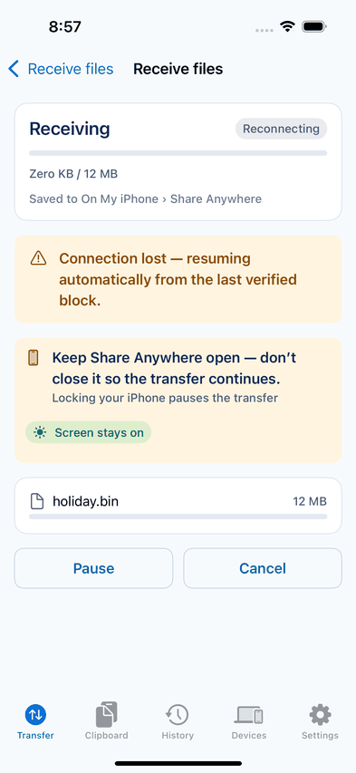
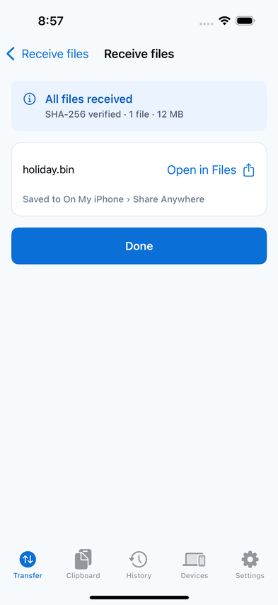
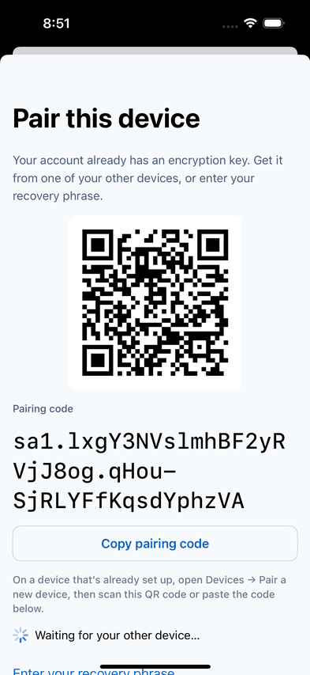

# Phase 7 report: iOS app

Status: exit gate met. QA round 7 PASS (`docs/qa/PHASE_7_QA.md`); CI [43215838875](https://github.com/Juliolayme/share_anywhere/actions/runs/43215838875) on 2f0aa95 green in every job including `ios-simulator` (iPhone 16, iOS 18.5) and `android-emulator (API 34)`; nightly [43215838879](https://github.com/Juliolayme/share_anywhere/actions/runs/43215838879) on 2f0aa95 green in every job including the iOS matrix (SE, 16 Pro Max, oldest runtime, XXXL), `ios-background-suspend` and `ios-web-interop` (64 MB each way and the encrypted clipboard exchange). The `UIPasteControl` item is met as narrowed by ADR 0028 (the control's tap is on the real-device checklist). File sharing is guest-first on iOS: Welcome leads to Transfer, send and receive never ask for an account, and the account sheet opens only from account entry points (Settings Sign in, Clipboard, Devices).

Every "tested" claim below was executed in GitHub Actions on the macOS 15 runner (Xcode 16.4, iOS 18.5 simulator SDK) against the Go backend run natively (`testhooks` build, Homebrew PostgreSQL 16). The simulator device is named per run; the runner image offers only iOS 18.x runtimes for Xcode 16.4, so the nightly "oldest runtime" entry also ran on iOS 18.5.

## 1. What was implemented

**Implemented and tested**

- **Core package (7.1).** `ios/ShareAnywhereCore` (SwiftPM, Swift 6 language mode, iOS 16 / macOS 13): wire protocol and frames byte for byte with the Web and Android (`shared/protocol/schemas/transfer-vectors.json`), the transfer engine (scheduler, bitmap, block cache, streaming SHA-256), account-key crypto with the shared vectors (CryptoKit through swift-crypto, vendored Argon2id; ADR 0024), the generated API models and client, device identity with the refresh secret in the Keychain, and SQLite History (ADR 0025). `swift test` runs on Linux in the cloud session and on macOS in the `ios` CI job.
- **App shell (7.2).** XcodeGen project (ADR 0022), design tokens and the EN/VI String Catalog generated from `shared/`, Welcome once, Transfer home, History with filters and detail, Devices (This device), Settings, pinned SwiftLint/SwiftFormat/XcodeGen, the `ios-simulator` reusable workflow.
- **Send and receive (7.3).** `SATransferRuntime` in the core package: sessions, the WebSocket (`URLSessionWebSocketTask`, one-time ticket, ordered outbox, backoff), the sender and receiver controllers ported from Android (offer/answer per receiver, capability check, reports through the transfer state machine, 2/10-minute reconnect windows, History), hidden partial files with sidecar bitmaps and resume. StreamWebRTC 145.25.0 behind a `PeerLink` protocol (ADR 0026). Screens: Send (document picker in place, 20 GB limit, Require approval off by default, open-session cap), Session (QR, code, link, 10:00 countdown on the server clock, Code expired with Create new code, Session full, capacity, Stop accepting, participants with security words, Approve/Reject, Remove/Block, per-receiver progress and result), Receive (code entry; camera scanning on devices), Join preview, waiting for approval, where to save (Documents or a picked folder), progress, result with Open in Files. Keep screen on (`isIdleTimerDisabled`, keep-open banner, screen-on pill, "Locking your iPhone pauses the transfer") and the background policy (grace period, pause, `ios.susp_h`, resume; ADR 0027). Share links open the join preview (Universal Links on devices, `shareanywhere://j/<token>` in tests).
- **Accounts and Clipboard (7.4).** `SAAccount` in the core package ported from Android: key flows with the authenticity checks of `docs/CLIPBOARD_PROTOCOL.md` §1.13, account keys with a sealed vault (Secure Enclave-derived key on hardware, Keychain key on the simulator), the account manager (wipe when the account session ends, key checks, history sync, revoke then rotate), encrypted history sync, and the Clipboard Sync engine with its encrypted cache, offline queue and sensitive heuristics. App: the account sheet (sign in, create account, reset, add this device, key setup, pairing or recovery phrase, checklist), Settings account rows and sign-out, account devices with rename, revoke and Pair a new device, the Clipboard tab (guest intro with no pasteboard access, Paste control, fallback read, foreground capture on return to the app, hints, banners, timeline, detail, clear), the Home Screen quick action. Flags `accounts` and `clipboard` on.

**Implemented but untested on a real device** (`docs/runbooks/ios-real-device-checklist.md`, all marked manual)

- Camera QR scanning (AVFoundation + Vision): simulators have no camera.
- Universal Links: need a signed build with the associated domain and `SA_APPLE_APP_ID` on Caddy.
- Real background suspension timing, Low Power Mode, screen lock behaviour.
- The Secure Enclave path of the key vault (simulators have no Enclave).
- Files app integration with iCloud Drive and external providers, storage full on a device, VoiceOver walkthrough.

**Partially implemented / planned**

- Route strategy beyond direct P2P with the TURN credentials (Phase 8), Cloud Distribution (Phase 8).
- Change password and two-step verification are not on iOS (`docs/design/DESIGN_DEVIATIONS.md` section N).
- `android-ios-interop` (best effort in the phase file) is not built.

## 2. Usable screens and routes (iOS)

Welcome, Transfer home, Send, Session (`session`, `session-expired`, `dashboard-done`, `dashboard-partial`), Receive (`receive`, `receive-code`), Join preview (`rx-preview`), Waiting (`rx-wait`), Receiving (`rx-progress`), Result (`rx-done`), History and detail, Devices (This device; account devices; Pair a new device), Settings (guest header with Sign in; account rows), Sign in, Create account, Reset password, Add this device (`trust`), Key setup, Pair this device (code/QR or phrase), Checklist, Sign out, Clipboard (intro, add device, key steps, home, detail). Screen IDs follow `docs/UX_SCREEN_MAP.md` §12; differences from the design are in `docs/design/DESIGN_DEVIATIONS.md` sections L, M and N.

## 3. End-to-end workflows executed

On the iOS Simulator in GitHub Actions (macOS 15 runner, Xcode 16.4, iOS 18.5 runtime; iPhone 16 in `ci.yml`, iPhone SE (3rd generation), iPhone 16 Pro Max, iPhone 16 on the oldest runtime at or above iOS 16 (18.5 on this image) and iPhone 16 at accessibility XXXL in the nightly), against the Go backend run natively with PostgreSQL 16. The other device is a `TestPeer` (or `AccountPeer`) in the test runner over real WebRTC and the real API, or the Web app in Playwright Chromium:

- **As a guest** (no sign-in anywhere): fresh install, Welcome, then Transfer home (`GuestLaunchUITests`); the Clipboard tab as a guest with zero pasteboard reads and zero change observations; anonymous identity and rename.
- **As a guest, sending:** seeded files, Create share session, six-digit code, open join by a second device (no approval step), the receiver gets the file with a matching SHA-256 and the sender sees `dashboard-done`; Require approval and Approve; Remove and Block (a blocked device cannot rejoin); the join window expires on the backend test clock into Code expired, an expired code admits nobody, Create new code issues a different code and the receiver who already joined still completes its transfer.
- **As a guest, receiving:** wrong code refused, join by code, join preview, where to save, receive into Documents with a matching SHA-256, local History after relaunch; pause and resume; a share link opened through the system shows the join preview (nothing joined until Receive); a receive paused by leaving the app (2 s grace) resumes on return with no block verified twice (`ios-background-suspend`).
- **Keep screen on:** `isIdleTimerDisabled` true while waiting and receiving, false after completion, pause and cancel and with the setting off, the pill turning it off and on for the session, false as applied when the app left the screen, true again on return.
- **Signed in:** sign up from Settings, add this device, set up the key (12-word recovery phrase), Go to Clipboard closes the account sheet, the Paste control is shown and text syncs through the fallback read, sign out gives a new anonymous device identity; a second account device pairs the app by the pasted code, items cross both ways encrypted, text copied while the app is in the background is not captured there and is captured on return (seen by the other device).
- **iOS ↔ Web** (`ios-web-interop`, all guests for files): Web → iOS 64 MB and iOS → Web 64 MB with SHA-256 checked on both ends; signed in, the Web's encrypted clipboard item decrypts on iOS and the iOS item decrypts on the Web (`clipboard-cross-client`, iOS half).
- **Screenshots** in light, dark and XXXL (`ScreenshotUITests`), plus flow screenshots; a selection is in `docs/phases/reports/assets/phase7-ios-*.png` (iPhone 16, iOS 18.5):

       

  Also committed: `phase7-ios-dark-home`, `light-send`, `session-approval`, `dashboard-done`, `rx-preview`, `rx-save`, `light-settings`, `dark-signin`, `light-clipboard-guest`, `light-history`, `dark-devices`.

## 4. Commands and results

- `cd ios/ShareAnywhereCore && swift test` (Linux, Swift 6): 96 tests, 0 failures; the same suite on macOS in the `ios` job.
- `swiftformat --lint .` and `swiftlint lint --strict` over `ios/` (pinned tools): clean.
- `pnpm -s i18n:check`: EN/VI catalogs current (2111 keys), the iOS String Catalog current.
- `cd web && pnpm -s lint && pnpm -s typecheck && pnpm -s test`: clean, 461 tests (the reporter fix and its test).
- `go test -race ./internal/clipboard` against PostgreSQL 16: pass (the fan-out test fix, 5 repeated runs).
- `npx markdownlint-cli2 "docs/**/*.md"`: 0 errors.
- CI [43215838875](https://github.com/Juliolayme/share_anywhere/actions/runs/43215838875) on 2f0aa95: all 16 jobs green (`backend`, `web`, `protocol`, `security`, `docs`, `compose`, five `e2e-web` projects, `android`, `android-emulator (API 34)`, `ios`, `ios-simulator`). Earlier: [43209011319](https://github.com/Juliolayme/share_anywhere/actions/runs/43209011319) on 620519f also green in every job.
- Nightly [43215838879](https://github.com/Juliolayme/share_anywhere/actions/runs/43215838879) on 2f0aa95: all 14 jobs green (`ios-matrix` × 4, `ios-background-suspend`, `ios-web-interop`, `android-matrix` 29 and 35, `android-web-interop`, `clipboard-cross-client`, `five-receivers`, `large-file`, `mobile-snapshots`, `plan`).
- The app and UI-test targets build only on macOS; this session has no Xcode, so every app and XCUITest result above comes from CI.

## 5. Environment variables and external services

- Build settings (`ios/project.yml`): `SA_BACKEND_URL` (Debug default `http://127.0.0.1:8080`; Release requires HTTPS), `SA_PUBLIC_URL` (share-link origin; defaults to the backend URL).
- Launch arguments for UI tests only (`-uiTesting`, Debug builds): `-backendURL`, `-publicURL`, `-resetState`, `-seedHistory`, `-seedSendFiles N`, `-seedFileBytes N`, `-backgroundGrace S`, `-theme light|dark`.
- Release builds: set `SA_APPLINKS_HOST` (public host for the `applinks:` associated domain) and `SA_BACKEND_URL` / `SA_PUBLIC_URL` (HTTPS); an empty `SA_APPLINKS_HOST` gives a build without working Universal Links.
- Caddy: `SA_APPLE_APP_ID` serves `apple-app-site-association` for Universal Links.
- No external services beyond the backend stack.

## 6. Known limitations and untested behaviours

- **Simulator only.** Nothing ran on a real iPhone. Untested until the real-device checklist (`docs/runbooks/ios-real-device-checklist.md`) is run: camera QR scanning, Universal Links (Release entitlement `applinks:$(SA_APPLINKS_HOST)` plus Caddy's `apple-app-site-association`), real background suspension timing and screen lock, Low Power Mode, the Secure Enclave path of the key vault, the system document picker with iCloud Drive and other providers, storage full, VoiceOver.
- **Not asserted by UI tests:** the local notification request when a receive pauses in the background; screen-on after a receiver is removed (the receiver side of Remove has no UI test; the sender side is covered); the "Screen-on is off in Settings" pill tap that turns the setting back on.
- **Simulator runtimes.** The macOS 15 image with Xcode 16.4 offers only iOS 18.x runtimes and no iPhone 15 simulators, so CI uses iPhone 16 / SE / 16 Pro Max, and the "oldest runtime" nightly entry ran on iOS 18.5, not iOS 16. The iOS 16 deployment target is compiled for but not executed.
- **Dynamic Type XXXL** runs the screenshot suite only; the flows run at the default size.
- **No pinned CI certificate.** The phase file asks Debug builds to pin the CI self-signed Caddy certificate for the interop job. Instead, the interop job serves Caddy over plain HTTP on localhost (`infra/caddy/Caddyfile.macos`), which only Debug builds accept; Release requires HTTPS and uses the system trust store. No certificate is bundled in any build.
- **TURN** credentials are fetched and passed to WebRTC, but forced-relay transfers are not tested until Phase 8 (`turn-forced`).
- **Not built:** `android-ios-interop` (best effort in the phase file); Android and iOS each interoperate with the Web, which shares the protocol vectors with both.
- **iOS's Paste control** (`UIPasteControl` through SwiftUI `PasteButton`) is shown and asserted in UI tests, but XCUITest cannot operate it, so syncing it by tap is untested (real-device checklist, ADR 0028); the automated clipboard tests sync through the fallback button and iOS's Allow Paste prompt. Under UI tests the sign-up password field is a plain field (the simulator's password AutoFill swallows typing), so the `SecureField` with `.newPassword` is untested by automation.
- **Foreground capture limits:** a copy made before the app launched or before Clipboard Sync was ready (signed in, this device added, key set up) is not captured automatically (the Paste control syncs it); Universal Clipboard text that iOS reports while the app is in front is treated like an in-app copy and not captured (a recorded departure from PRD §7.3b, deviation N.3); `detectPatterns` gets one second before the text is read and checked by the engine instead (ADR 0028); copies made inside the app are never captured automatically (Paste control or fallback only); Universal Clipboard text arriving while the app is in front is expected at the next return (untested). Untested on a real device: the paste prompt as users see it, Universal Clipboard.
- Change password and two-step verification stay off iOS (`docs/design/DESIGN_DEVIATIONS.md` section N).

## 7. Backlog

- **P0:** none known.
- **P1:** run the real-device checklist on a signed build (camera, Universal Links, background timing, Secure Enclave); assert the background-pause notification request in a UI test; run the suite on an iOS 16 runtime when a runner image offers one.
- **P2:** `android-ios-interop`; a receiver-side Remove UI test (screen-on off after removal); file names bounded by UTF-8 length rather than characters; a Release build in CI; connection-log sheet on the session screen; Change password on iOS; XXXL flows beyond screenshots.

## 8. Local run

```bash
cp .env.example .env
docker compose up -d --build
scripts/ios-tools.sh
(cd ios && ../.tools/xcodegen/bin/xcodegen generate)
open ios/ShareAnywhere.xcodeproj
```

Run the `ShareAnywhere` scheme on an iOS Simulator; the Debug build talks to `http://127.0.0.1:8080`. On Linux, `cd ios/ShareAnywhereCore && swift test` runs the core tests.

## 9. Commits

On `claude/practical-lovelace-avlb5g`: bca342a, 61581d8, 907ddb5, 4913d15, 0565fb7, b52b1b8 (7.1); d5ac37a, ef2facf, 0f50151, 26b73ca, 0c75984, 38b124c, fd86d09, 4559340, c340a6b, 7aeca93, 2564d30, 36df2e2 (7.2); a88aabd, da2de0b, dcf5933 (7.3); 44b08be, f190986, 37acafc, d28ebdf, 5ec4b94, 436c65e, b99aead (7.4); QA and CI: a5a9dda, fb4bbf6, 01583c4, cf5f03a, c5b1716, c44dd26, aa9a8a0, 206a6b6, 8565ad4, 1e54e62, a102d5f, 622df03, 4f2ce54, 5c92bf4, 9d7af09, e96e372, 6908ed2, 620519f, 2f0aa95; report and QA record: the commit that adds this report (`docs: Phase 7 report and QA record`).
